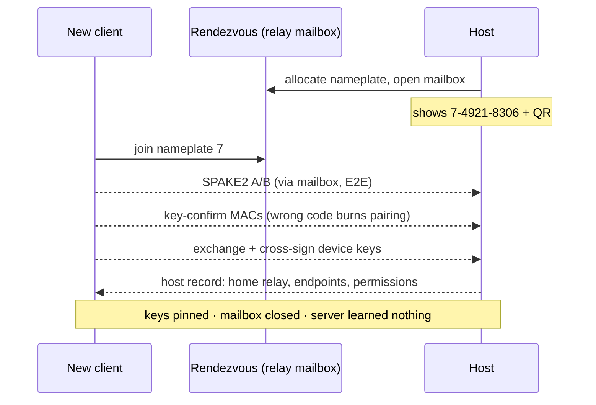

# tachyx — architecture

Open-source remote desktop: screen + keyboard/mouse first. Rust core, Flutter clients, Rust relays.
Positioning: RustDesk's openness + Parsec's latency + Mullvad's economics + WireGuard's audit posture.

Working name `tachyx` (tachys = fast). All names provisional.

---

## 1. Design pillars

1. **Zero-trust infrastructure.** Relays and coordination move ciphertext and routing metadata only.
   Access to a host is granted exclusively by key pairing between devices. Compromise of our cloud
   must never grant access to anyone's desktop. This is what makes self-hosting, community relays,
   and anonymous accounts safe.
2. **One transport: QUIC.** Unreliable datagrams for video, reliable ordered streams for
   input/control, connection migration for Wi-Fi↔LTE handoff, 0-RTT resume. WebTransport is QUIC,
   so the web client shares the protocol instead of forking to WebRTC.
3. **Direct-first, relay-metered.** Hole punching succeeds for most pairs (target 85–90%) and is
   free forever, even at zero balance. Relays are the paid fallback — Mullvad-style pay-per-GB.

Minimalism is applied where it buys security: the **audited core** is the protocol — transport,
handshake, pairing, framing (~5–8k lines, published as a spec document like the WireGuard
whitepaper). The media stack (encoders, capture) is inherently vendor glue; it lives behind traits
in a separate **unprivileged, sandboxed process** (seccomp, no keys in its address space) and is
swappable.

---

## 2. Components

| Component | Binary | Role |
|---|---|---|
| Host daemon | `hostd` | Capture, encode, input injection, policy, pairing list. Runs headless on a workstation. |
| CLI | `tachyx` | Thin client over `hostd`'s Unix socket. |
| Client apps | Flutter | Desktop, mobile, web. Embed the Rust client core (FFI / wasm). Can also embed the host lib ("share this machine" toggle drives `hostd` over the same socket API). |
| Relay | `relayd` | Zero-trust ciphertext forwarder + rendezvous mailboxes + presence. One static musl binary; self-hostable. Cloud fleet = same binary with billing module enabled. |
| Coordination | `coordd` | Accounts, balances, token issuance, Stripe webhooks, signed relay directory, host→home-relay lookup. **Not on the connection path.** |

**Home relay:** each host keeps one persistent QUIC connection to its lowest-RTT relay (probed from
the signed relay list). That connection is presence + rendezvous channel + fallback data path.
Reconnects to a paired host never touch `coordd` — the client cached the home relay at pairing
time. `coordd` down ⇒ no new pairings/top-ups; existing users unaffected.

**Federation is safe** (unlike Tailscale DERP): a hostile relay can drop/delay traffic but never
read or inject into a session, so community relays and the paid fleet are interchangeable
trust-wise.

---

## 3. Identity, pairing, auth

### Device identity
- Ed25519 keypair generated on first run; private key in the platform keystore
  (Secret Service / TPM-backed where possible on Linux, Keychain, Android Keystore/StrongBox).
- Public key **is** the device ID.
- Accounts are Mullvad-style random 16-digit numbers, zero PII, used only for billing and
  directory lookups. Losing the account loses balance, never access — access lives in pinned keys.

### Pairing (first contact) — PAKE
- Host allocates a **nameplate** (short mailbox number) on its home relay and generates a secret.
- Display: QR (primary) = 128-bit secret + host public key + relay hint.
  Typed fallback = `nameplate-secret`, e.g. `7-4921-8306` (**8-digit** secret).
- Client joins the nameplate; both run **SPAKE2** over the mailbox; key-confirmation MACs both ways.
- **One attempt per code.** A wrong guess burns the code and alerts loudly on the host.
- Inside the SPAKE2 channel: exchange device certs, mutually cross-sign public keys, client stores
  the host record (home relay, last endpoints), host stores the client key + permissions.
- Optional short-auth-string (emoji triplet) shown on both screens for human verification.

### Why the short code is safe
PAKE ⇒ zero offline attack; an active MITM (including a malicious rendezvous) gets exactly **one
online guess per pairing**. At 8 digits that is 10⁻⁸ per attempt; across 10M pairings a fully
malicious rendezvous expects ~0.1 successes. The QR path carries the full secret **and** the host
key, so even a malicious server gets **zero** guesses. Nameplate collisions are impossible by
construction — the relay allocates them.

### Every subsequent connection
Mutual TLS 1.3 where each side presents a self-signed cert bound to its Ed25519 key and verifies
the **exact pinned key** (rustls raw-public-key or custom verifier). No CA. No server in the loop.

### Attacker checklist
| Attacker | Outcome |
|---|---|
| Passive network observer | SPAKE2 group elements + TLS ciphertext; learns nothing |
| Active MITM / evil rendezvous | One burned guess (typed) or zero (QR) |
| Compromised `coordd` DB | Public keys + balances; can deny service, cannot impersonate/decrypt |
| Compromised relay | Forwards ciphertext it cannot read; worst case drops packets |
| Stolen client device | Revoke that one key on the host |
| Residual | Endpoint compromise; relay-visible metadata (who↔whom, when, bytes) |

### Host-side policy (per paired device)
Permissions: `view` | `control`; `unattended` yes/no (no ⇒ local click to accept); revocable any
time. **No ID+password unattended mode, ever** — that is the remote-support-scam vector.

### Web client auth
No long-term keys in browser storage. Every web session is an ephemeral device approved
WhatsApp-Web-style (QR + PAKE from a paired device), or via LAN share (below).

---

## 4. Handshakes

### Pairing



### Session (every connect)

```mermaid
sequenceDiagram
    participant C as Client
    participant R as Home relay
    participant H as Host
    C->>R: QUIC connect + sealed offer for H
    R->>H: deliver opaque offer
    C->>R: observed address + candidates
    H->>R: observed address + candidates
    C->>H: simultaneous QUIC open (hole punch)
    Note over C,R,H: punch failed ⇒ relay splices the two pipes (physical only)
    C-->>H: E2E QUIC/TLS 1.3, pinned keys — identical direct or relayed
    C-->>H: capabilities (codecs, subsampling, viewport, fps, HDR)
    H-->>C: stream config (e.g. AV1 4:2:0, 1440p60, host downscales 4K)
    C-->>H: media datagrams + reliable input stream
```

Solid arrows = physical links; dashed = end-to-end content the relay cannot read. The relay does
the STUN job itself (reports each peer's reflexive address over the existing connection — no
separate STUN infra). Relayed sessions run the *same* E2E QUIC handshake through the spliced pipe.

---

## 5. Capability negotiation (codec, subsampling, resolution)

Exchanged on the first E2E control flight; re-sending the same struct mid-session = live
renegotiation (window resize, tablet rotation, monitor hotplug).

- **Client advertises:** decoders (codec, profile, max level/res/fps, 10-bit, 4:4:4), viewport in
  physical px, device pixel ratio, HDR.
- **Host advertises:** encoders, capture formats, monitor list.
- **Host picks** from a deterministic preference table:
  codec AV1 > HEVC > H.264 when hardware exists on both ends;
  subsampling 4:2:0 default, 4:4:4 only when both ends support it or user enables "text mode".
- **Skip 4:2:2 entirely** — AV1 Professional-profile only, near-zero hardware decode support; a
  negotiation branch that never fires.
- **Resolution modes:**
  - `fit` (default): encode at min(capture, client viewport); host GPU downscales *before* encode
    (VA-API VPP / Vulkan blit) — a 4K desktop streams to a 1080p tablet at 1080p.
  - `native`: full host resolution, client scales locally (bandwidth-hungry, crisp when zooming).
  - Under both, the congestion controller may temporarily step down the encode ladder without
    touching the negotiated target.
- Keyboard is HID usage codes (layout-independent; host applies layout). Cursor shape/position sent
  as metadata and rendered client-side.

---

## 6. Transport & latency machinery

- **Video → QUIC DATAGRAM** (RFC 9221), sliced so one lost packet kills a slice, not a frame.
  Never retransmitted.
- **Input/control → one reliable ordered stream** (tiny; HOL blocking irrelevant).
- **Loss recovery without retransmit:** intra-refresh (rolling I-columns, no IDR spikes) +
  long-term reference frames — on loss, client requests a P-frame off the last acked LTR;
  recovery costs one frame interval. Optional FEC parity for lossy mobile links.
- **Congestion control:** delay-based estimator (GCC/SCReAM-style, one-way delay gradients from
  receiver feedback) retargets the *encoder* at ~85% of estimate; BBR-ish pacing in QUIC beneath.
  Desktop/KBM degradation ladder: hold fps and chroma on text, drop bitrate → resolution.
- **Mobile:** QUIC connection migration keeps the session alive across Wi-Fi↔LTE.
- **Perceived latency:** client-side cursor rendering; input batched at 500–1000 Hz into 2–4 ms
  ticks; clock-sync handshake feeds a Parsec-style stats HUD (per-stage ms) from day one.
- **Budget:** capture 1–2 ms · encode 2–5 · pace ~1 · network one-way · jitter 0–2 frames ·
  decode 2–5 · present ≤1 vsync. Added latency over raw RTT: **~10–20 ms**.

**Build-vs-buy:** prototype punching + relays on **iroh** (quinn-based, magicsock-style). Keep the
protocol agnostic to the connection layer; decide later whether a slimmer bespoke layer is worth it
once real-world punch rates are known.

---

## 7. Media pipeline (Wayland host first)

**Capture** — default: `xdg-desktop-portal` ScreenCast → PipeWire → DMA-BUF frames + damage
regions; `restore_token` persisted for unattended re-grant. Second backend for wlroots-family
(Hyprland etc.): `ext-image-copy-capture-v1` direct — no portal round-trip, ideal headless.
Damage awareness: static screen ⇒ near-zero bitrate, instant ramp on change.

**Encode** — hardware first: VA-API (Intel/AMD), NVENC. MVP via GStreamer *inside the sandboxed
media process*, behind `FrameSource`/`Encoder` traits; replace hot paths with direct libva/NVENC
later. Low-latency settings: zero B-frames, slice encoding, tight VBV/CBR, intra-refresh, LTR.

**Inject** — default: portal RemoteDesktop (libei); direct wlroots `virtual-pointer` /
`virtual-keyboard` backend for compositors that support it.

**Decode/present (client)** — Vulkan Video / VideoToolbox / MediaCodec / WebCodecs; mailbox
present mode; local cursor overlay; adaptive 0–2-frame jitter buffer.

**Codec rollout:** H.264 and AV1 are both negotiated today, per session, from what each end
probes at run time; H.264 is the fallback and decodes literally everywhere incl. WebCodecs.
Android advertises H.264 only, because its decoder is configured from the bitstream and only an
H.264 sequence parameter set reader is written. Next: HEVC only where hardware on both ends →
4:4:4 "text mode".

**Web client:** WebTransport + WebCodecs, wasm client core, canvas/WebGPU present. Position as
"check on your machine" — browser event loop will not match native input latency.

---

## 8. LAN share (`tachyx temp`)

Instant local screen sharing: no internet, no relay, no account.

- `tachyx temp [--view-only] [--ttl 15m]` (or a GUI button) mints an **ephemeral session keypair**
  (stable device key never broadcast) and announces
  `Name._tachyx._udp.local` via mDNS: port, ephemeral cert SPKI hash, offered permissions,
  human tag (e.g. `blue-fox-42`).
- Native viewers browse the service and pick from a list (device name + tag). Crowded office
  collisions are a UI-selection problem; picking wrong just fails the code check, because
  **mDNS is spoofable ⇒ the on-screen short code + PAKE is mandatory even on LAN.**
- Sharer chooses `view` or `control` at share time; grant evaporates on disconnect/TTL.
- **Web viewer trick:** browsers can't mDNS and reject self-signed LAN TLS — but WebTransport
  `serverCertificateHashes` connects to any address given the exact (short-lived ECDSA) cert hash.
  Host shows a QR = `ip:port + cert hash + secret`; colleague scans, hosted web app opens and
  connects **directly over the LAN**. Zero-install viewing; cloud never sees a byte.

---

## 9. CLI (`tachyx` over `hostd` Unix socket; `--json` everywhere)

```
tachyx status                        # daemon, home relay + RTT, live sessions:
                                     # peer, direct/relayed, codec, res, fps, bitrate,
                                     # RTT, loss, duration, bytes up/down
tachyx pair                          # code + QR in terminal
tachyx temp [--view-only] [--ttl t]  # LAN share
tachyx pairings list
tachyx pairings revoke <fp|name>
tachyx pairings set <fp> --allow view|control --unattended true|false
tachyx pairings rename <fp> <name>
tachyx sessions kill <id>
tachyx stats                         # lifetime counters per peer, direct vs relayed bytes
tachyx doctor                        # portal check, encoder detection, NAT class, punch self-test
```

Config: single TOML (XDG). Counters: small local SQLite/state file.

---

## 10. Relay design

- One static binary. QUIC listener. Functions: presence, rendezvous mailboxes,
  reflexive-address reporting, ciphertext splicing between two authenticated flows, byte counters.
- Never holds session keys. Per-IP connection caps + rate limits.
- **Self-hosted mode:** same binary, public IP, systemd unit; billing module off; friends/team use
  it with zero accounts.
- Cloud fleet: relay selection is client-side RTT probing against a signed relay list (no anycast
  at this scale). Start regions: Falkenstein, Helsinki, Ashburn, Singapore.
- Capacity: a relayed stream is 5–20 Mbit/s ⇒ an unmetered 1 Gbit dedicated box (~€40–60/mo)
  carries 50–150 concurrent relayed sessions; with 85–90% direct rate that is thousands of active
  users per box. Start on cloud VMs (20 TB included), graduate to dedicated.

---

## 11. Coordination & storage — SQLite, deliberately

`coordd` workload after moving mailboxes to relays: accounts, devices, balances, token issuance,
Stripe webhook, relay directory, host→home-relay lookup. Low-write, tiny, **not** on the
connection path ⇒ single-node SQLite is correct, not a compromise.

- axum + `sqlx` on SQLite (WAL mode); **Litestream** → Hetzner Object Storage (S3-compatible) for
  continuous backup + point-in-time restore.
- Keep SQL boring; Postgres migration remains possible if multi-node is ever needed.
- **Double-spend without Redis:** blind tokens are issued *bound to a specific relay*; each relay
  keeps its own local spent-set. No shared state between relays. (Issuer learns which relay you'll
  use — coarse metadata, same class Mullvad sees.)

---

## 12. Billing

- **Model:** sell GB of relay traffic; GB never expire (data, not subscription). Direct sessions
  free forever, even at zero balance. Control channel over relay always free (bytes are trivial)
  so a broke account still sees host status.
- **MVP:** relay meters bytes against the account (documented honestly).
  **v1.1:** Privacy Pass-style blind RSA tokens (RFC 9474/9578) — issuer sees the account but never
  the token; relay sees the token but never the account. Bearer tokens ≈ 100 MB each, spent as
  traffic accrues. Design the token API now so the swap is invisible.
- **Stack:** Stripe Checkout (hosted page ⇒ no card data on our servers ⇒ PCI SAQ-A) + webhook
  crediting GB, idempotent via stored event IDs in SQLite. Runs inside `coordd`.
- **EU VAT (CZ seller, B2C digital across EU):** Stripe Tax + quarterly OSS filings, **or** a
  merchant of record (Paddle / Lemon Squeezy, ~5%) that owns VAT entirely. Recommendation: start
  MoR, reclaim margin later. Crypto later via self-hosted BTCPay.
- **Never sell GB in-app on iOS/Android** — web top-ups only (Mullvad-style), or lose 30% and the
  anonymous-account story in review.
- **Economics:** Hetzner marginal egress ~€1/TB ⇒ €5 / 500 GB is >90% margin; 500 GB ≈ 100+ hours
  of *relayed* 1440p60, which most users barely touch.

---

## 13. Hosting & ops

- All Hetzner. 1 small VM (`coordd` + SQLite + Litestream, Caddy for TLS) + N relay boxes.
- **NixOS everywhere**, static Rust binaries as packages, deploy with `colmena`/`deploy-rs`,
  systemd units. No Docker, no k8s.
- Reproducible builds via Nix + signed releases + published protocol spec = the credible
  "audit us like WireGuard" story. NixOS module + Home Manager module as first-class install
  targets, alongside static binary + systemd unit and distro packages.
- Prometheus endpoints in every binary from day one; add a single VictoriaMetrics+Grafana box when
  there is something to watch. Uptime monitoring from the start.

---

## 14. Crates (well-known only)

| Area | Crates |
|---|---|
| Runtime / transport | `tokio`, `quinn`, `rustls` (RPK / pinned-cert verifier), `iroh` (initial punching+relay layer) |
| API / storage | `axum`, `tower`, `sqlx` (SQLite) |
| Crypto | `ed25519-dalek`, `x25519-dalek`, `spake2`, later `blind-rsa-signatures` |
| Serialization | `prost` (protobuf) for control plane; **hand-specified 16-byte header** for media framing (in the spec) |
| Host / client | `gstreamer-rs` (sandboxed, behind traits), `keyring`, `mdns-sd`, `flutter_rust_bridge` v2 |
| Plumbing | `clap`, `tracing`, `thiserror`/`anyhow`, `toml`+`serde` |

Rule: own the protocol and crypto glue; never hand-roll what a boring mainstream crate does.
Supply chain: `cargo vet`/`cargo audit` in CI.

---

## 15. Repo layout

```
tachyx/
  crates/
    proto/          # wire format + handshake — the audited, spec'd heart
    transport/      # QUIC, punching, relay client (iroh-backed initially)
    crypto/         # device identity, SPAKE2 pairing, pinning (thin)
    media-host/     # capture + encode traits + sandboxed process
    media-client/   # decode + present glue
    client-core/    # FFI for Flutter (native + wasm)
    hostd/          # daemon
    relayd/         # relay (+ optional billing module)
    coordd/         # accounts, billing, directory
    cli/            # tachyx
  app/              # desktop, mobile, web UI
  spec/             # protocol document (the "whitepaper")
  nix/              # packages, NixOS modules, deploy
```

---

## 16. MVP & roadmap

**MVP:** Wayland portal host · Linux/macOS/Android clients · negotiated AV1 or H.264 · direct + relay ·
PAKE pairing (QR + 8-digit) · fit-mode scaling · CLI incl. `doctor` · simple metered billing ·
stats HUD.

**Fast-follows, in order:** audio (PipeWire makes it nearly free; its absence is complaint #1) →
clipboard → AV1 → blind tokens → LAN share polish → multi-monitor selection → Windows/iOS clients →
file drag-and-drop → web client → 4:4:4 text mode → Windows/macOS hosts.

**Milestone one (de-risks everything at once):** `hostd` on a Hyprland box + Linux Flutter client;
portal capture → VA-API → quinn datagrams over LAN; pinned-key auth; stats HUD.

---

## 17. Known risks

1. **Unattended Wayland access** is the swamp: `restore_token` persistence across reboots, headless
   sessions, GNOME's special-cased remote login — per-compositor quirks. Budget it as a workstream.
2. **Mobile-network congestion control** is years of tuning at Parsec; ship conservative defaults,
   instrument everything.
3. **Web client** will trail native input latency; position accordingly.
4. **Abuse:** short-lived pairing codes + no ID/password unattended mode is the defense; keep it
   even when users ask for "easier".
5. **Media-stack sprawl** vs. the minimal ethos: contained by the sandboxed-process + trait
   boundary; the audited surface stays the protocol.
