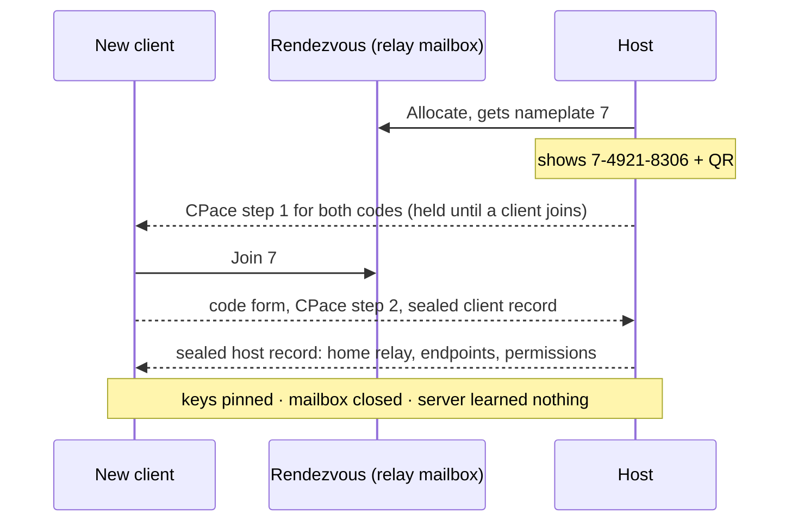
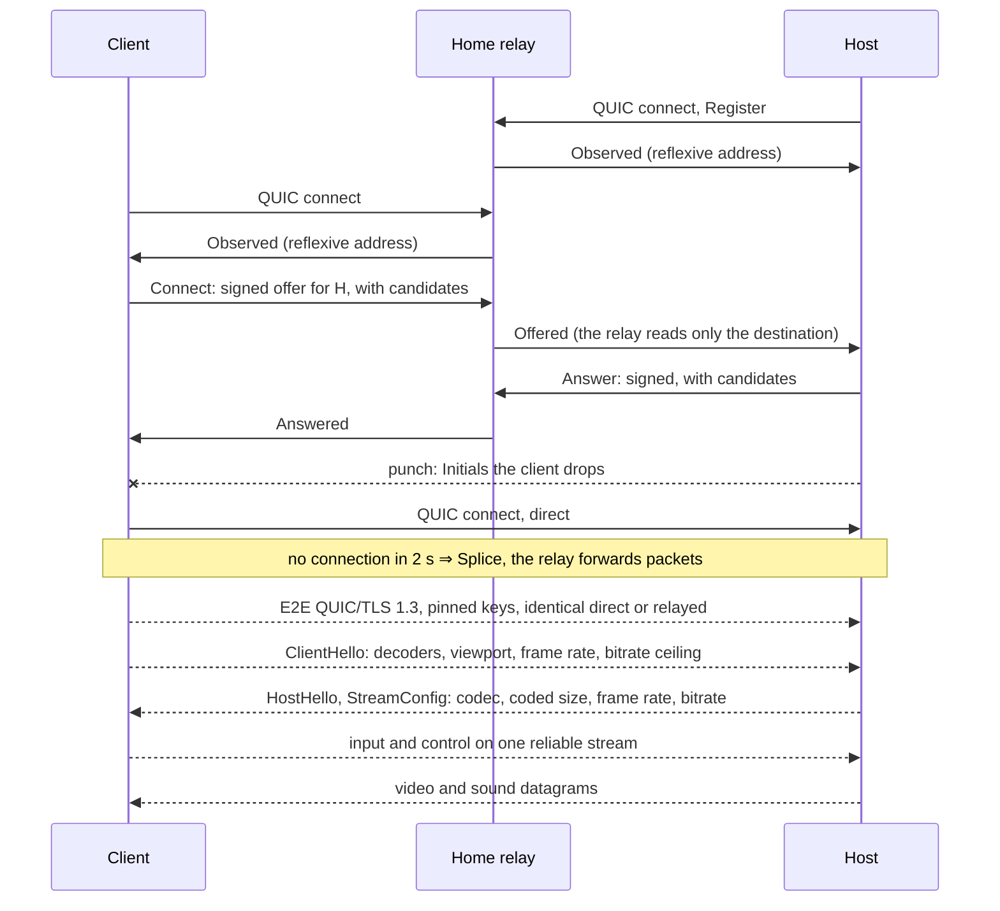

# tachyx architecture

tachyx is an open-source remote desktop: screen, keyboard and pointer first.
The core and the relay are Rust. The clients are Flutter. The goal: latency
close to a local display, a protocol small enough to audit, relays paid per GB,
and no server that can grant access to a desktop.

This is the original overall design, and part of it is not built. Each section
starts with its status, checked against the code: **built**, **partly built**
(the section says which parts), or **not built** (design only). The built parts
have their own specifications, which win where they disagree with this one:
[`protocol.md`](protocol.md) (session), [`pairing.md`](pairing.md) (identity and
pairing), [`relay.md`](relay.md) (relay), [`congestion.md`](congestion.md) (rate
control). [`findings.md`](findings.md) records the parts of this design that
measurement disproved. They stay here, marked.

Names are provisional. `tachyx` is from the Greek *tachys*, fast.

---

## 1. Design pillars

Status: partly built. Pillar 1 holds for the built code. Pillar 2 holds except
0-RTT and tested migration (section 6). Pillar 3: direct first is built,
metering is not.

1. **Zero-trust infrastructure.** Relays and coordination carry ciphertext and
   routing metadata only. Access to a host comes only from key pairing between
   devices. A compromise of the project's servers must never give access to a
   desktop. This is what makes self-hosting, community relays and anonymous
   accounts safe.
2. **One transport: QUIC.** Unreliable datagrams for video, one reliable ordered
   stream for input and control, connection migration for a Wi-Fi to LTE
   handoff, 0-RTT resume. WebTransport is QUIC, so a web client shares the
   protocol instead of a fork to WebRTC.
3. **Direct first, relay metered.** Hole punching should succeed for most pairs
   (target 85 to 90%, not measured, see relay.md). Direct sessions are free
   forever, even at zero balance. Relays are the paid fallback: per GB,
   prepaid on an anonymous account in the style of Mullvad.

The audited core is the protocol: transport, handshake, pairing, framing.
Target: 5 000 to 8 000 lines, published as a specification in the style of the
WireGuard paper. The media stack (capture, encode) is vendor glue. The design
puts it behind traits in a separate **unprivileged, sandboxed process**
(seccomp, no keys in its address space). **Not built:** it runs inside
`tachyx-hostd`.

---

## 2. Components

Status: partly built.

| Component | Binary | Role | Status |
|---|---|---|---|
| Host daemon | `tachyx-hostd` | Capture, encode, input injection, sound, pairing list, home relay connection. Runs headless on a workstation. | Built |
| CLI | `tachyx-hostd <subcommand>` | Thin client over the daemon's Unix socket. Section 9. | Built |
| Client apps | Flutter | Embed the Rust client core (FFI, or wasm for web). Design also: a "share this machine" toggle that drives `tachyx-hostd`. | Linux and Android built. Web, iOS, macOS, Windows, share toggle not built. |
| Relay | `relayd` | Ciphertext forwarder, rendezvous mailboxes, presence. Self-hostable. Design: the cloud fleet is the same binary with a billing module. | Built, no billing |
| Coordination | `coordd` | Accounts, balances, token issuance, Stripe webhooks, signed relay directory, host-to-home-relay lookup. **Not on the connection path.** | Not built |

**Home relay.** Each host keeps one persistent QUIC connection to its home
relay: presence, rendezvous channel and fallback data path in one. Design: the
lowest-RTT relay from the signed relay list. Built: the first relay in the
host's configuration. The client stores the home relay at pairing, so a
reconnect to a paired host never needs `coordd`. Pairing needs only a relay, so
a `coordd` outage would stop only top-ups and directory lookups.

**Federation is safe.** A hostile relay can drop or delay traffic but never read
or inject into a session, so community relays and the paid fleet are
interchangeable in trust. relay.md has the full threat statement.

---

## 3. Identity, pairing, auth

Status: built, except the platform keystore, accounts, web client auth and
enforcement of per-device permissions. pairing.md is the specification.

### Device identity

- Built: an Ed25519 key pair, generated on first run. The public key **is** the
  device ID. The private seed is a 0600 file (`device.key`) on hosts, relays
  and clients.
- Not built: the key in a platform keystore (Secret Service or TPM, Keychain,
  Android Keystore or StrongBox). pairing.md, *What is not here*, says why the
  key stays a file and stays Ed25519.
- Not built: accounts. Design: Mullvad-style random 16-digit numbers, no
  personal data, for billing and directory lookups only. Losing the account
  loses balance, never access: access lives in pinned keys.

### Pairing (first contact): PAKE

Built.

- The host opens a mailbox on its home relay. The relay allocates the
  **nameplate** (a short mailbox number), so nameplates cannot collide.
- The host shows two codes for that mailbox, each with its own secret. QR
  (primary): 128-bit secret, host public key, relay address. Typed fallback:
  `nameplate-secret`, for example `7-4921-8306` (**8-digit** secret).
- Both ends run **CPace over Ristretto255** through the mailbox. The design
  said SPAKE2; pairing.md says why it changed. Each sealed record is its own
  key confirmation. There are no separate MACs.
- **One attempt per code.** The first reply consumes the exchange. A wrong
  guess closes the mailbox, the host logs it, and `pair` fails. The client
  never resends a spent code.
- Inside the channel: the client sends its key and name, then the host sends its
  key, name, home relay, endpoints and permissions. Each side stores the other.
- Three emoji (18 bits) show on both screens for an optional human check.
- Not built, by decision: cross-signing of device keys (pairing.md).

### Why the short code is safe

PAKE allows no offline attack. An active MITM, including a malicious
rendezvous, gets **one online guess per code**. At 8 digits that is 10⁻⁸ per
guess. Across 10M pairings a fully malicious rendezvous expects about 0.1
successes. Against a hostile relay that bound rests on the client never
resending a spent code (pairing.md, *One attempt per code*). The QR carries the
full secret **and** the host key, so even a malicious server gets no useful
guess.

### Every subsequent connection

Built. Mutual TLS 1.3. Each side presents a self-signed certificate bound to
its Ed25519 key and verifies the **exact pinned key** with a custom rustls
verifier. No CA, no server in the loop, no trust on first use.

### Attacker checklist

| Attacker | Outcome |
|---|---|
| Passive network observer | CPace group elements and TLS ciphertext. Learns nothing. |
| Active MITM or hostile rendezvous | One burned guess (typed) or none (QR) |
| Compromised `coordd` database (design) | Public keys and balances. Can deny service, cannot impersonate or decrypt. |
| Compromised relay | Forwards ciphertext it cannot read. Worst case: drops packets. |
| Stolen client device | Revoke that one key on the host |
| Residual | Endpoint compromise. Relay-visible metadata: who talks to whom, when, how many bytes. |

### Host-side policy (per paired device)

Permissions: `view` or `control`, and `unattended` yes or no (no means a local
click accepts each session). Revocable at any time. **No ID-and-password
unattended mode, ever**: that is the remote-support-scam vector.

Partly built. The host records both flags at pairing, changes them with
`pairings set`, and tells the client. **The session does not enforce them
yet**: input from a view-only device is injected, and nothing asks for a local
click.

### Web client auth

Not built. Design: no long-term keys in browser storage. Every web session is
an ephemeral device, approved WhatsApp-Web-style (QR and PAKE from a paired
device) or through LAN share (section 8).

---

## 4. Handshakes

Status: built. pairing.md and relay.md have the detail.

### Pairing



### Session (every connect)



Solid arrows are physical links. Dashed arrows are end-to-end content the relay
cannot read. The relay does the STUN job itself, over the existing connection.
A relayed session runs the *same* handshake through the splice. Before it asks
the relay, the client tries the endpoints stored at pairing.

---

## 5. Capability negotiation (codec, subsampling, resolution)

Status: partly built. protocol.md is the specification.

Built:

- **Client advertises** in `ClientHello`: viewport in physical pixels, largest
  decodable size and its frame rate, requested frame rate, bitrate ceiling, and
  the codecs it can decode, probed at run time.
- **Host** probes its encoders at startup and picks AV1 over H.264 when both
  ends have it. No common codec ends the session. Design: the host also
  advertises encoders, capture formats and a monitor list. Built: it sends only
  whether it has sound and the chosen `StreamConfig`.
- The codec is chosen once. Re-sending the capabilities mid-session
  (`ViewportChanged`: resize, rotation, picture-in-picture) renegotiates
  resolution and bitrate ceiling.
- **Resolution (`fit`):** encode at min(capture, viewport). The host GPU scales
  *before* encode, so a 4K desktop streams to a 1080p tablet at 1080p. The
  congestion controller steps down a ladder below that without touching the
  negotiated target.
- Keyboard is HID usage codes (layout-independent, the host applies its
  layout). Cursor shape and position travel as metadata. The client draws the
  cursor.

Not built: HEVC (design preference: AV1 > HEVC > H.264 when both ends have
hardware), 4:4:4 "text mode" (design: only when both ends support it, or on
request; built: 4:2:0 only), `native` mode (full host resolution,
client scales), codec change mid-session, monitor hotplug, 10-bit, HDR.

Decision kept: **no 4:2:2.** It is AV1 Professional profile only, with almost
no hardware decode. The branch would never run.

---

## 6. Transport and latency machinery

Status: partly built. protocol.md and congestion.md are the specifications.

Built:

- **Video on QUIC DATAGRAM** (RFC 9221), never retransmitted. Design: sliced,
  so a lost packet costs a slice, not a frame. Built: one slice (H.264) or tile
  (AV1) per picture, because four slices encoded slower (8.81 ms mean against
  7.30).
- **Input and control on one reliable ordered stream.** It is tiny, so
  head-of-line blocking does not matter.
- **Loss recovery without retransmission:** Reed-Solomon parity that follows
  measured loss (zero on a clean link), and a key frame on client request.
  Bitrate changes, resolution changes and requests share one key-frame budget.
- **Congestion control:** a delay-based estimator (one-way delay gradients from
  the receiver report) retargets the *encoder*. BBR in quinn beneath. Degrade
  order: bitrate, then frame rate, then resolution (design: hold frame rate and
  chroma on text, drop bitrate, then resolution). Datagrams are paced and
  marked DSCP EF.
- **Perceived latency:** client-side cursor, input batched into 4 ms ticks, a
  stats overlay.

Not built:

- **Intra refresh and long-term reference frames.** Design: rolling intra
  columns instead of key-frame spikes, and on loss a P-frame off the last
  acknowledged LTR, so recovery costs one frame interval. The VA-API GStreamer
  elements expose neither (findings.md). Every recovery is a full key frame.
- **Clock-sync handshake** for per-stage latency. The receiver report needs no
  synchronised clocks.
- **0-RTT resume.**
- **Migration across Wi-Fi and LTE.** quinn migrates passively. No test moves a
  live session between networks.
- **iroh.** Design: prototype punching and relays on iroh. Built instead:
  directly on quinn, with the protocol in relay.md.

**Latency budget (design, not measured end to end):** capture 1 to 2 ms, encode
2 to 5, pace about 1, network one-way, jitter 0 to 2 frames, decode 2 to 5,
present at most one vsync. Added latency over raw RTT: **about 10 to 20 ms**.

---

## 7. Media pipeline (Wayland host first)

Status: partly built. Built for wlroots compositors, developed on Hyprland.
findings.md has the measurements.

**Capture.** Built: `ext-image-copy-capture-v1` direct into DMA-BUF. Capture
blocks until the screen changes, so a static screen sends nothing. Design, not
built: `xdg-desktop-portal` ScreenCast through PipeWire, "DMA-BUF frames +
damage regions", with `restore_token` for unattended re-grant. Measured: the
Hyprland portal is a screencopy client that republishes through PipeWire (more
hops, not less latency), and the compositor reports full damage on every frame.

**Encode.** Built: VA-API through GStreamer (`vah264enc`/`vah264lpenc`,
`vaav1enc`/`vaav1lpenc`) inside the daemon. Variable bitrate (constant bitrate
filled 87% of a static desktop's stream with padding), zero B-frames, one slice
or tile, one reference frame. Not built: NVENC, direct libva, intra refresh,
LTR, the sandboxed media process.

**Inject.** Built: wlroots `virtual-pointer` and `virtual-keyboard`. Not built:
portal RemoteDesktop (libei), the design default.
`xdg-desktop-portal-hyprland` does not offer it.

**Keep awake, priority.** Built: a session holds an idle inhibitor, because a
blanked output sends no frames and the remote user cannot wake it. Picture
threads get realtime priority through rtkit.

**Decode and present (client).** Built: Linux, GStreamer VA-API decode into a
GL texture. Android, MediaCodec into a Flutter surface producer. No CPU copy on
either. Not built: Vulkan Video, VideoToolbox, WebCodecs.

**Sound.** Built (protocol.md, *Sound*). The host taps the monitor source of the
sound server's default sink, never a device named by hand:
`pulsesrc ! audioconvert ! audioresample ! opusenc`, 48 kHz stereo, 128 kbit/s,
10 ms frames, own thread. One Opus packet per datagram, past the pacer: a paced
key frame takes tens of milliseconds, and a gap in sound is an audible click.
Sound and picture share one session clock (`CLOCK_MONOTONIC`), so the client
can align them. Sound costs about 141 kbit/s, which the host takes off the
video target while it flows.

The tap is **before** the sink's volume and mute. So the host's volume is the
one knob: the client applies the gain the host reports. `Exclusive` mode mutes
the host and the client still hears everything. A guard holds that mute for the
life of the mode, so a client that drops never leaves the host silent. One
PulseAudio client connection (pipewire-pulse answers it too) reads and writes
volume, mute and the default sink, and its subscription carries host-side
changes to the client without polling.

**Codecs.** Built: H.264 and AV1, negotiated per session from what each end
probes. H.264 is the fallback and decodes everywhere, WebCodecs included.
Android offers AV1 only when its default AV1 decoder is hardware. Next, not
built: HEVC (only where both ends have hardware), then 4:4:4 text mode.

**Web client.** Not built. Design: WebTransport, WebCodecs, the client core in
wasm, canvas or WebGPU present. Scope: "check on your machine". A browser event
loop will not match native input latency.

---

## 8. LAN share (`tachyx temp`)

Status: not built. No mDNS code exists.

Design: instant local screen sharing with no internet, no relay, no account.

- `tachyx temp [--view-only] [--ttl 15m]` (or a GUI button) mints an
  **ephemeral session key pair** (the stable device key is never broadcast) and
  announces `Name._tachyx._udp.local` over mDNS: port, ephemeral certificate
  SPKI hash, offered permissions, human tag (for example `blue-fox-42`).
- Native viewers browse the service and pick from a list (name and tag). In a
  crowded office a collision is a selection problem: a wrong pick fails the
  code check. **mDNS is spoofable, so the on-screen short code and PAKE are
  mandatory on a LAN too.**
- The sharer grants `view` or `control` at share time. The grant ends at
  disconnect or TTL.
- **Web viewer.** Browsers cannot use mDNS and reject self-signed LAN TLS, but
  WebTransport `serverCertificateHashes` connects to any address given the
  exact hash of a short-lived ECDSA certificate. The host shows a QR with
  `ip:port`, the certificate hash and the secret. A colleague scans it, and the
  hosted web app connects **directly over the LAN**. No install, and the cloud
  never sees a byte.

---

## 9. CLI (subcommands on `tachyx-hostd`, `--json` everywhere)

Status: built.

```
tachyx-hostd [run]                    # the daemon; a bare invocation runs it
tachyx-hostd id                       # this host's device identifier
tachyx-hostd status                   # daemon, home relay, live sessions
tachyx-hostd pair [--view-only] [--attended] [--ttl 4m] [--no-qr]
tachyx-hostd pairings list
tachyx-hostd pairings revoke <device|name>
tachyx-hostd pairings set <device|name> [--allow view|control] [--unattended true|false]
tachyx-hostd pairings rename <device|name> <name>
tachyx-hostd sessions kill <id>
tachyx-hostd relay list | add <address:port#KEY> | remove <address:port>
tachyx-hostd doctor
```

- `<device|name>`: a full identifier, an unambiguous prefix, or a name. Names
  are tried only when no identifier matches, because the peer chooses its name.
- `pairings set` needs `--allow`, `--unattended` or both, and keeps what is not
  named. `pair --ttl` defaults to 4 minutes, at most 5 (the relay's mailbox
  life). `relay add` accepts a bare `address:port` for an unpinned relay
  (relay.md). `relay remove` removes every relay at that address.
- One binary. Everything but `run` is a thin client over the daemon's socket at
  `$XDG_RUNTIME_DIR/tachyx/hostd.sock` (directory mode 0700). A second binary
  would be one more thing to install and keep in step.
- `doctor` and `relay` work with the daemon down. `doctor` exists for that case.
  It reports the daemon, the device key and its mode, the encoders, sound, the
  compositor's capture, injection and idle-inhibit protocols, each relay, and
  the number of paired devices. `relay` then edits the file directly.
- `--json` (`-j`) prints one JSON value on standard output, and errors as JSON
  on standard error with a non-zero exit. `pair` shows a code and keeps
  reporting, so it prints JSON Lines, with the link instead of a drawn QR.
- Configuration: one TOML file, `$XDG_CONFIG_HOME/tachyx/hostd.toml`. `relay`
  edits it in place, so a hand-written file keeps its comments.

Not built: `tachyx temp` (section 8) and `tachyx stats` (lifetime counters have
nowhere to live).

---

## 10. Relay design

Status: partly built. relay.md is the specification.

Built: one binary, `relayd`, one UDP port (47990). Presence, rendezvous
mailboxes, reflexive-address reporting, splicing between two authenticated
peers, byte counters per lane. No session keys, nothing stored across a
restart. New connections rate limited per IPv6 `/64` (or IPv4 address), control
messages per connection, QUIC retry for an unvalidated source over budget.
**Self-hosted mode:** the same binary on a public address, no accounts. It
prints its `address:port#KEY` line at startup.

Not built:

- The billing module and a systemd unit.
- **Cloud fleet:** client-side relay selection by RTT probes against a signed
  relay list (no anycast at this scale). Start regions: Falkenstein, Helsinki,
  Ashburn, Singapore.
- **Capacity (estimate):** a relayed stream is 5 to 20 Mbit/s, so an unmetered
  1 Gbit/s dedicated server (about €40 to €60 a month) carries 50 to 150
  concurrent relayed sessions. At 85 to 90% direct, that is thousands of active
  users per server. Start on cloud VMs (20 TB included), then move to dedicated.

---

## 11. Coordination and storage: SQLite, deliberately

Status: not built.

With mailboxes on the relays, `coordd` handles accounts, devices, balances,
token issuance, the Stripe webhook, the relay directory and the
host-to-home-relay lookup. It writes rarely, is small and is **not** on the
connection path, so single-node SQLite is correct, not a compromise.

- axum and `sqlx` on SQLite (WAL). **Litestream** to Hetzner Object Storage
  (S3-compatible) for continuous backup and point-in-time restore.
- Plain SQL, so Postgres stays possible if multi-node is ever needed.
- **Double-spend without Redis:** blind tokens are issued *bound to one relay*,
  and each relay keeps its own spent set. No shared state between relays. The
  issuer learns which relay a user will use: coarse metadata, the class Mullvad
  sees.

---

## 12. Billing

Status: not built.

- **Model:** sell GB of relay traffic. GB never expire (data, not a
  subscription). Direct sessions free forever, even at zero balance. Control
  over a relay always free (trivial bytes), so a zero balance still sees host
  status.
- **MVP:** the relay meters bytes against the account, and the documentation
  says so. **v1.1:** Privacy Pass-style blind RSA tokens (RFC 9474, RFC 9578).
  The issuer sees the account but never the token. The relay sees the token but
  never the account. Bearer tokens of about 100 MB, spent as traffic accrues.
  The token API is designed now, so the swap is invisible.
- **Stack:** Stripe Checkout (hosted page, so no card data on project servers:
  PCI SAQ-A) and a webhook that credits GB, idempotent through event IDs stored
  in SQLite. Inside `coordd`.
- **EU VAT** (Czech seller, B2C digital sales across the EU): Stripe Tax with
  quarterly OSS filings, **or** a merchant of record (Paddle or Lemon Squeezy,
  about 5%) that owns VAT. Plan: start with a merchant of record, reclaim the
  margin later. Crypto later through self-hosted BTCPay.
- **No GB sales in the iOS or Android apps.** Web top-ups only, as Mullvad does.
  In-app sales cost 30% and put the anonymous-account model at risk in review.
- **Economics:** Hetzner marginal egress is about €1 per TB, so €5 for 500 GB is
  over 90% margin. 500 GB is over 100 hours of *relayed* 1440p60, more than
  most users ever need.

---

## 13. Hosting and ops

Status: not built. `flake.nix` holds a development shell only.

- All on Hetzner: one small VM (`coordd`, SQLite, Litestream, Caddy for TLS)
  and N relay servers.
- **NixOS everywhere:** static Rust binaries as packages, deployed with
  `colmena` or `deploy-rs`, as systemd units. No Docker, no Kubernetes.
- Reproducible Nix builds, signed releases and a published protocol
  specification make an audit like WireGuard's credible. Install targets: NixOS
  and Home Manager modules, a static binary with a systemd unit, distribution
  packages.
- A Prometheus endpoint in every binary. A VictoriaMetrics and Grafana server
  once there is something to watch. Uptime monitoring from the start.

---

## 14. Crates (well-known only)

Status: the crates in use. Planned ones are marked.

| Area | Crates |
|---|---|
| Runtime, transport | `tokio`, `quinn`, `rustls` (custom pinned-key verifiers), `rcgen`, `socket2` |
| Crypto | `ring` (Ed25519, ChaCha20-Poly1305, HKDF), `pake-cpace`, `zeroize`. Planned: `blind-rsa-signatures` |
| Serialization | `postcard` + `serde` for control and relay messages. **Hand-specified 16-byte header** for media datagrams (protocol.md) |
| Media | `gstreamer-rs`, `reed-solomon-simd`, `opus`, `libpulse-binding` |
| Host, relay | `wayland-client`, `wayland-protocols`, `gbm`, `rtkit-rs`, `qrcode`, `governor` |
| Client | `flutter_rust_bridge` v2, `irondash_texture`, `ndk`, `jni` |
| API, storage | Planned: `axum`, `tower`, `sqlx` (SQLite) |
| Plumbing | `clap`, `tracing`, `thiserror`, `anyhow`, `toml`, `toml_edit`, `serde_json`, `data-encoding` |

Planned but not used: `iroh` (quinn directly), `prost` (`postcard`), `spake2`
(CPace), `ed25519-dalek` and `x25519-dalek` (`ring`), `keyring` (the key is a
file), `mdns-sd` (no LAN share).

Rule: own the protocol and the crypto glue. Never hand-roll what a boring
mainstream crate does. Supply chain: `cargo vet` and `cargo audit` in CI. Not
built: there is no CI configuration.

---

## 15. Repository layout

Status: built. The design had `proto`, `transport`, `crypto`, `media-host`,
`media-client`, `client-core`, `hostd`, `relayd`, `coordd`, `cli` and `nix/`.
The code has:

```
tachyx/
  crates/
    tachyx-proto/        # wire format: control messages, media header, parity
    tachyx-transport/    # QUIC endpoints, datagrams, control stream, pacing, pinned TLS
    tachyx-crypto/       # device identity, CPace pairing, paired-device records
    tachyx-relay/        # relay protocol, peer side, routing socket, rendezvous
    tachyx-relayd/       # the relay
    tachyx-congestion/   # delay-based rate control
    tachyx-media/        # Wayland capture, VA-API encode, sound capture
    tachyx-input/        # wlroots pointer and keyboard injection
    tachyx-sched/        # realtime priority through rtkit
    tachyx-hostd/        # host daemon and CLI
    tachyx-client/       # client core, no I/O
    tachyx-driver/       # client I/O: connection, session, decoder feed, pairing
    tachyx-video/        # client decode and present
    tachyx-audio/        # client Opus decode and playback
    tachyx-client-ffi/   # flutter_rust_bridge boundary
    tachyx-unsafe/       # the one crate that permits unsafe
  app/                   # Flutter client (Linux, Android)
  spec/                  # specifications and findings
  flake.nix              # development shell
```

Not built: `coordd`, a separate CLI crate, `nix/`.

---

## 16. MVP and roadmap

Status: each item marked. [`roadmap.md`](roadmap.md) has the current order.

**MVP (design):** Wayland portal host, Linux, macOS and Android clients,
negotiated AV1 or H.264, direct and relay, PAKE pairing (QR and 8-digit),
fit-mode scaling, CLI with `doctor`, simple metered billing, stats display.
Built: all of it except the macOS client and billing. The host uses wlroots
protocols, not the portal.

**Fast-follows, in the original order:** audio (built: host output, the host's
volume as the one knob), clipboard, AV1 (built: negotiated per session), blind
tokens, LAN share polish, multi-monitor selection, Windows and iOS clients,
file drag-and-drop, web client, 4:4:4 text mode, Windows and macOS hosts. All
items not marked built are not built. The host captures one output, named in
its configuration. More than one client at a time is not built.

**Milestone one:** `tachyx-hostd` on Hyprland and the Linux Flutter client:
capture, VA-API, quinn datagrams over a LAN, pinned-key auth, stats display.
Built, with `ext-image-copy-capture-v1` instead of the portal.

---

## 17. Known risks

Status: design. findings.md and [`assumptions.md`](assumptions.md) record what
the built code has met.

1. **Unattended Wayland access:** `restore_token` persistence across reboots,
   headless sessions, GNOME's special-cased remote login, quirks per
   compositor. Budget it as a workstream. The built host avoids the portal and
   so runs only on wlroots compositors.
2. **Congestion control on mobile networks** took Parsec years of tuning. Ship
   conservative defaults and instrument everything.
3. **Web client** input latency will trail native. Scope it to match.
4. **Abuse:** short-lived pairing codes and no ID-and-password unattended mode
   are the defence. Keep both when users ask for "easier".
5. **Media-stack sprawl** against a minimal core. Design answer: the sandboxed
   process and trait boundary keep the audited surface to the protocol. Not
   built: the media stack runs in the daemon.
