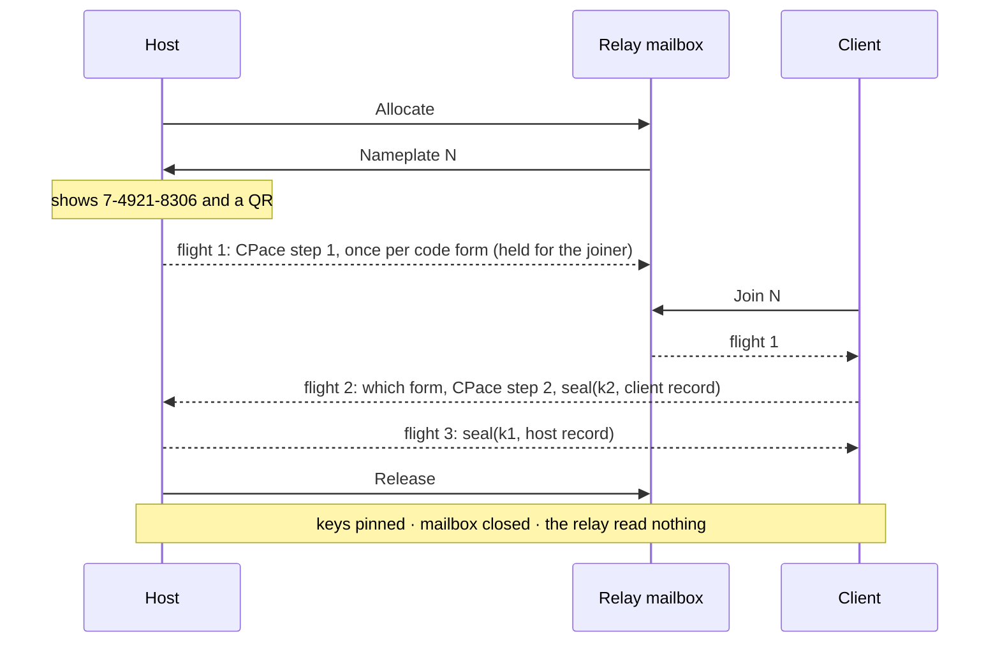

# tachyx pairing and device identity (draft 0)

Status: draft. This document is the audited surface. Each claim is implemented
(in `crates/tachyx-crypto` unless the text names another place) or is marked as
not built.

It answers two questions: *what is a device*, and *how do two devices come to
know each other*. After the first meeting, every connection is a key
comparison. [`protocol.md`](protocol.md) describes the session that comparison
protects.

## What a device is

A device is one Ed25519 key pair. The public key **is** the device identifier.

```
DeviceId = Ed25519 public key (32 bytes)
```

Text form: base32 without padding ([RFC 4648]), upper case, 52 characters. It
is read back in either case, because people retype it. Lists show a short form:
the first 12 characters in three groups of four (60 bits). Every comparison uses
all 32 bytes. The short form never decides anything.

Nothing else names a device. There is no certificate authority, no account, and
no server that can vouch for a device. A host on a local network has no name a
public authority would sign, and an account that could grant access would be a
thing to steal.

### The secret on disk

One file, `device.key`: 32 bytes, mode 0600 (set when the file is created), in
the state directory (`$XDG_STATE_HOME/tachyx/` on the host). It holds a seed,
not a key:

```
signing seed = HKDF-SHA256(secret = seed, salt = "", info = "tachyx device ed25519 v1")
```

The indirection costs one hash. It allows a second key of a different kind
later, with no second file and no migration. Nothing else is derived from the
seed now.

The seed is read at startup and the file is not touched again. A headless
daemon cannot reach a keyring: there is no session bus, no unlocked collection
and no user to unlock one. So the file is the store, protected the way an SSH
host key is protected.

### The certificate

TLS needs a certificate. The certificate carries nothing the key does not, so it
is derived from the key at every start and never stored:

```
signing seed = HKDF-SHA256(secret = seed, salt = "", info = "tachyx device ed25519 v1")
PKCS#8 v1     = 302e020100300506032b657004220420 || signing seed
certificate   = self-signed, subject "tachyx", Ed25519, from that key
```

The PKCS#8 structure takes the **signing seed**, not the seed on disk. The two
are one hash apart, and the file's own bytes would build a different identity.

A peer reads the certificate's subject public key info, checks the 12-byte
Ed25519 prefix, and takes the last 32 bytes. That is the `DeviceId`, and it is
compared to the pinned one byte for byte. Validity dates and subject names are
not examined: the certificate is self-signed, so a forger writes what it likes
into both, and the key is the only thing an attacker has to break.

**Both ends present a certificate and both ends check one.** The host requires a
client certificate and refuses a device it has not paired with. There is no
trust on first use.

**A refusal reaches the client on its first read, not on its connect.** TLS 1.3
sends the client's certificate in the client's second flight. Over QUIC, the
client sees its handshake complete before the host has checked who it is. The
client learns of the refusal at its next read, and the reason is in the
connection close. Code that reports a failed connection to a person must read
before it decides.

The host reads the paired list *inside* the handshake, not from a copy made at
startup. A revocation takes effect at that device's next connection, not at the
next daemon restart.

## The pairing code

Pairing runs over a **mailbox** on a relay: a numbered, one-shot, two-party
message queue that the relay forwards without reading. See
[`relay.md`](relay.md).

A code names a mailbox and carries a secret.

```rust
pub struct PairingCode {
    /// Which mailbox on the relay. Allocated by the relay, so codes cannot
    /// collide. A NonZeroU16.
    pub nameplate: Nameplate,
    pub secret: PairingSecret,
}

pub enum PairingSecret {
    /// Read off the screen and typed. Eight decimal digits, held below
    /// 100_000_000 by the newtype.
    Typed(TypedSecret),
    /// Scanned. Sixteen bytes.
    Scanned([u8; 16]),
}
```

The two forms are one type because both enter the key exchange the same way. A
session in which one end used one form and the other end used the other must
not be representable.

For one pairing the host draws **two different secrets**, one per form, for the
same mailbox (`PairingCodes`). One shared secret would give the scanned path
the strength of the typed one.

### Typed

```
7-4921-8306
```

Nameplate `7`, secret `49218306`: 26.6 bits. The secret is drawn by rejection
sampling, so all 10⁸ values are equally likely. Dashes and spaces after the
nameplate are ignored on input.

### Scanned

```
tachyx://pair?c=<BASE32>
```

The base32 body is this structure, in `postcard`:

| Field | Bytes | Purpose |
|---|---|---|
| version | 1 | Refuse, by name, a code that a later version reshaped. |
| host | 32 | The host's `DeviceId`. |
| secret | 16 | 128 bits. |
| nameplate | 1 to 3 | Which mailbox. |
| relay | ~24 | Where that mailbox is: `host:port`. |

The relay's key is not in the QR: the exchange protects the mailbox, and the
authenticated relay address arrives in the host record. The client dials only a
configured relay: the one the link names if it is in the list, else the first.

The scheme is lower case, because Android matches an intent filter's scheme
case-sensitively and does not normalise the URI. The reader accepts either
case. The body is upper-case base32, because QR alphanumeric mode encodes
`0-9 A-Z` at 5.5 bits a character against 8 in byte mode. The `qrcode` crate
does the ISO Annex J segment split, so the body goes in alphanumeric mode and
the scheme in byte mode with no extra code. A reader refuses a link over 512
characters (`MAX_URI`).

Measured on the drawn code, error correction level L: a link that names the
relay by address is 124 to 127 characters and draws a version 5 code (37
modules, 45 columns by 23 rows of half-block glyphs). One that names a
26-character host name is 143 characters: version 6, 41 modules, 49 by 25. Rows
run out first: 25 already exceed a default 24-row terminal. A test in `code.rs`
holds the version 6 ceiling.

**The scanned form carries the host's device identifier. The typed form does
not.** That is the whole difference in what an attacker gets (see *One attempt
per code*).

## The exchange

Balanced PAKE, then one authenticated record each way. Three flights.



### The key exchange is CPace over Ristretto255

The crate is [`pake-cpace`]: 197 lines, `no_std`, `forbid(unsafe_code)`, by the
author of libsodium. Its source was read in full before it was adopted.

CPace, not SPAKE2, for two reasons, in this order.

**Ristretto255 has no cofactor.** SPAKE2 over Ed25519 must reason about a group
of order 8ℓ, about non-canonical encodings, and about points that decompress
outside the prime-order subgroup. Ristretto makes those states
unrepresentable: a `CompressedRistretto` decompresses to a prime-order element
or fails. The one remaining degenerate case, the identity, is rejected
explicitly.

**The crates.io alternative is a pre-release.** RustCrypto's `spake2` publishes
`0.5.0-pre.0`. Its last stable release, `0.4.0`, is from 2023. CPace is also
what the CFRG selected for the balanced case.

The exchange does not interoperate with the final CPace draft: the crate uses
an earlier draft's domain separation strings. Both ends are this code, so that
costs nothing.

Found in that reading: the crate hashes the password into the generator
zero-padded to a block boundary, with no length prefix, so two passwords that
differ only in trailing NUL bytes key the same exchange. No password this
protocol builds can hold a NUL. It is recorded for the next user of the crate.

### What goes into it

```
password  = "<nameplate>:<secret>"     canonical ASCII, one form per code
id_a      = "tachyx-host"
id_b      = "tachyx-client"
ad        = "tachyx-pair-v1"
```

The password carries the nameplate as well as the secret, so a code offered for
one mailbox cannot be replayed into another. The two forms cannot collide: the
typed secret is always 8 zero-padded digits and the scanned one always 26
base32 characters.

The identities are fixed strings, not device identifiers. The typed form does
not know the host's identifier, and both forms must build a transcript the host
can reproduce from what it put on screen.

### Two secrets means two exchanges, and the host runs both

The host does not know which of its two codes the client will use. So flight
one carries a CPace step-one packet for **each**. The client answers one and
names which. The host finishes that one.

The named form is the peer's word and is trusted for nothing else. A reply that
names the wrong form makes the host finish the other exchange, derive different
keys and fail to open the record: the outcome of any wrong code, and the same
one attempt spent.

Publishing both step-one packets costs one extra scalar multiplication and 48
bytes. It leaks nothing about either secret. A CPace step-one packet is a
random session identifier and a group element blinded by a fresh scalar: what a
passive observer sees in any CPace run. Two of them are two of those.

CPace returns two 32-byte keys. Each key has one direction and encrypts exactly
one message, so both nonces are zero and neither can repeat:

```
k1: host -> client
k2: client -> host
```

### Key confirmation is the AEAD, and nothing else

There are no separate confirmation MACs. Each record is sealed with
ChaCha20-Poly1305 under its direction's key. A record that opens proves the
peer derived the same key, which proves it knew the code. A record that does
not open is a wrong code. A tampered flight gives the same error (`WrongCode`)
on purpose: a finer error would be a finer answer to an attacker.

The direction is bound twice: by which key is used, and by the associated data,
`"tachyx pair host record v1"` or `"tachyx pair client record v1"`. One flight
cannot be presented as the other even if the keys were equal.

Each flight starts with a version byte, outside the sealed record. `postcard`
writes no field names, so a flight that a later version reshaped would otherwise
decode into plausible nonsense. All three flights are checked before anything
derived from them is used. The version is the peer's word and decides only
whether to keep reading. A flight larger than 8 KiB (`MAX_FLIGHT`) is refused
before it is decoded.

The order of reveals is deliberate:

- The **client** reveals first, sealed. A wrong guess, including an active
  attacker in the middle, gets a ciphertext it cannot open, so nothing leaks.
- The **host** reveals only after the client's record opened. A wrong guess
  never learns the host's identifier, its relay or its endpoints.

### One attempt per code, and where that rule actually lives

The rule lives in three places. Each covers a different case.

**In the types.** `HostPairing::start` takes `PairingCodes` by value, and
`PairingCodes` is neither `Copy` nor `Clone`. So one draw opens at most one
exchange. `HostPairing::finish` takes `self`, so that exchange answers at most
once. A second guess against one code cannot be written. The host
(`tachyx-hostd`) closes the mailbox after the first reply, whether the record
opened or not, and logs a failed attempt.

**On an honest relay, in the mailbox's structure.** A mailbox admits one joiner,
ever. A second join is refused (`NameplateTaken`). A joiner that leaves closes
the mailbox: it does not free the seat. The first reply to reach the host
consumes the exchange. A joiner that never replies has learned only flight one,
which is two uniformly random group elements. One join, at most one guess.

Burning the mailbox on the first join would add nothing. Against an honest
relay the structure above already holds. Against a hostile relay the join
notice would come from the relay, and the relay is the attacker. A defence that
asks the adversary to report the attack is not a defence.

**On the client, which is the only place the real gap closes.** A hostile relay
farms retries. It runs the exchange against the client under a guessed secret
and forwards nothing. The host sees no attempt, and the code stays on its
screen. The person reads "wrong code", assumes a typo and retypes it. Each retype
is one more free guess, charged to the person under attack.

So the client keeps the books. Once flight two is on the wire, the code is
spent at this end, whatever happens next (`PairFault::spent` in
`tachyx-driver`). The Flutter client refuses to offer a spent code again and
says to get a fresh one. `tachyx-driver` also tries only one relay per code,
because a retry on a second relay after a partial exchange would spend a second
guess. A hostile relay then gets one guess per code the host displays, the same
bound the honest structure gives. The host's five-minute mailbox life caps how
many codes exist at human speed.

The spent set is in memory (`app/lib/src/session/hosts.dart`), so an app
restart inside a mailbox's five-minute life allows one more guess at a code
still on the host's screen.

At eight digits one guess succeeds with probability 10⁻⁸. Across ten million
pairings a fully malicious rendezvous expects about 0.1 successes. With the
client's books that bound is per code, not per retype. The scanned form gives
the same attacker 2⁻¹²⁸ per guess **and** carries the host's identifier, which
the client compares with the record it opens (`WrongHost`). So a client on the
scanned path pins the right host even if the exchange itself were broken. None
of the retry analysis above applies to it.

### The records

```rust
pub struct ClientRecord {
    pub device: DeviceId,
    /// What to call this device in `tachyx-hostd pairings list`.
    pub name: String,
}

pub struct HostRecord {
    pub device: DeviceId,
    pub name: String,
    /// Where to find this host when it is not on the same network.
    pub home_relay: Option<RelayAddress>,
    /// Addresses worth trying before the relay is asked.
    pub endpoints: Vec<SocketAddr>,
    pub permissions: Permissions,
}

pub struct Permissions {
    /// False means view only: no input is injected.
    pub control: bool,
    /// False means a person at the host has to accept each session.
    pub unattended: bool,
}
```

A name is a label for a person reading a list. The peer chooses it, so it is
never trusted for anything: the identifier is what is compared. The host keeps
only the printable part of a received name, cut to 64 terminal columns. The
CLI matches a name only when no identifier or identifier prefix matches.

`tachyx-hostd pair` grants `control` and `unattended` unless `--view-only` or
`--attended` narrows them. `pairings set` changes them later. **The host session
does not enforce them yet.** It injects input from a view-only device, and
nothing asks a person to accept an attended session. The client stores the
permissions as a label only.

### Short authentication string

```
sas = HKDF-SHA256(secret = k1 || k2, salt = "", info = "tachyx pair sas v1")
```

Each of the first three bytes, modulo 64, picks one emoji from a fixed list of
64. Three emoji carry 18 bits. Both ends show them: the host's `pair` command
and the client's pairing screen. Comparing them is optional. It is the check
for someone who worries that the code was read aloud over a channel that was
listening. The exchange has already decided by the time the emoji can be
compared.

## What is not here

**No cross-signing.** [`architecture.md`](architecture.md) describes each side
signing the other's key. Nothing would read those signatures: the pin list is
the authorisation, and a signature that nothing verifies is a field to get
wrong. Adding one later needs no migration: a pairing without one predates it.

**No sealed offer.** [`relay.md`](relay.md) has the client *sign* its
rendezvous offer, not seal it to the host's key. Sealing would hide the
candidate addresses from the relay, but the relay observes the client's real
address anyway, so it would hide nothing new. The signature is what the offer
needs: it lets a host refuse a stranger before it sends one packet toward an
address a stranger named.

**No revocation beyond deletion.** Removing a device from the host's list
(`pairings revoke`) is the revocation. There is no revocation list, because
nobody else issued a certificate.

**No hardware-held key, and Ed25519 is why.** Apple's Secure Enclave holds P-256
only. Android's StrongBox is P-256 only too. Ed25519 reaches the Android
Keystore from API 33, but it is trusted execution at best, is emulated in
software on devices without KeyMint v2 while still reporting success, and has
no public API: the caller passes `ECGenParameterSpec("ed25519")` as a string.

So a hardware-held identity means P-256 and a private key outside this
process: the Rust core would call the platform for every TLS signature. That
work is not done.

It would also buy less than it seems. Google's Tink documentation says a
wrapped key on a device with file-based encryption adds little beyond device
binding, because the plaintext key must be in the process to sign anyway.
WireGuard's Android client writes its private key as text into the app's
private directory and stops there. So the key is a 0600 file, and Ed25519
stays: it is faster, has no per-signature nonce to get wrong, and has no
malleable encoding.

The choice is recorded, not settled. The wire format is not frozen. If a
hardware-held identity is wanted later, the device record gains a key type.

**Losing the key is a normal event, not a fault.** Keystore keys die on
uninstall, on a restored backup, when a lock screen is removed and when a new
fingerprint is enrolled. A file dies with its directory. Either way the device
becomes a new device and must pair again. So pairing is a first-class flow,
available at any time, not a step that happens once at setup.

[RFC 4648]: https://www.rfc-editor.org/rfc/rfc4648
[`pake-cpace`]: https://github.com/jedisct1/rust-cpace
