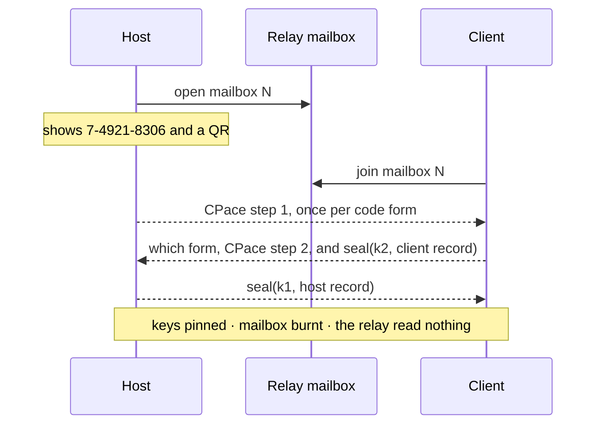

# tachyx pairing and device identity (draft 0)

Status: draft. This document is the audited surface. Every claim here is either
implemented in `crates/tachyx-crypto` or marked as not yet built.

Two questions are answered here. *What is a device* and *how do two devices come
to know each other*. Everything after the first meeting is a key comparison, and
[`protocol.md`](protocol.md) describes the session that comparison protects.

## What a device is

A device is one Ed25519 key pair. The public key **is** the device identifier:
32 bytes, written for people as base32 without padding ([RFC 4648], upper case),
in groups of four. It is read back case-insensitively, because it is a thing
people retype.

```
DeviceId = Ed25519 public key (32 bytes)
```

Nothing else names a device. There is no certificate authority, no account, and
no server that can vouch for one. A host on a local network has no name a public
authority would sign, and an account that could grant access would be a thing to
steal.

### The secret on disk

One file, `device.key`, 32 bytes, mode 0600, in the state directory. It holds a
seed, not a key:

```
signing seed = HKDF-SHA256(secret = seed, salt = "", info = "tachyx device ed25519 v1")
```

The indirection costs one hash and buys the ability to add a second key of a
different kind later without a second file or a migration. Nothing else is
derived from it today.

The seed is read into an `Ed25519KeyPair` at startup and the file is not touched
again. A headless daemon cannot reach a keyring: there is no session bus, no
unlocked collection, and no user to unlock one. So the file is the store, and it
is protected the way an SSH host key is protected, which is the honest answer
rather than a keyring that is not there.

### The certificate

TLS wants a certificate. The certificate carries nothing the key does not, so it
is derived from the key at every start rather than stored:

```
signing seed = HKDF-SHA256(secret = seed, salt = "", info = "tachyx device ed25519 v1")
PKCS#8 v1     = 302e020100300506032b657004220420 || signing seed
certificate   = self-signed, subject "tachyx", Ed25519, from that key
```

The **signing seed**, not the seed on disk. The two are one hash apart, and
writing the file's own bytes into that structure would build a different
identity.

A peer reads the certificate's subject public key info, checks the twelve-byte
Ed25519 prefix, and takes the last 32 bytes. That is the `DeviceId`, exactly, and
it is compared to the pinned one byte for byte. Validity dates and subject names
are not examined: the certificate is self-signed, so a forger writes what it
likes into both, and the key is the only thing an attacker has to break.

**Both ends present a certificate and both ends check one.** The host requires a
client certificate and refuses a device it has not paired with. This is the
change pairing makes to [`protocol.md`](protocol.md): before it, a host accepted
anything that could reach the port.

**A refusal reaches the client on its first read, not on its connect.** TLS 1.3
sends the client's certificate in the client's own second flight, so over QUIC
the dialling end sees its handshake complete before the host has looked at who
it is. The client learns it was refused when it next reads, and the reason is in
the connection's close. Anything that reports a failed connection to a person has
to read before it decides.

The list is consulted *inside* the handshake rather than copied at startup, so
revoking a device takes effect on that device's next connection and not on the
daemon's next restart.

## The pairing code

Pairing runs over a **mailbox** on a relay: a numbered, one-shot, two-party
message queue that the relay forwards without reading. See
[`relay.md`](relay.md).

A code names a mailbox and carries a secret.

```rust
pub struct PairingCode {
    /// Which mailbox on the relay. Allocated by the relay, so codes cannot
    /// collide.
    pub nameplate: Nameplate,
    pub secret: PairingSecret,
}

pub enum PairingSecret {
    /// Read off the screen and typed. Eight decimal digits.
    Typed(u32),
    /// Scanned. Sixteen bytes.
    Scanned([u8; 16]),
}
```

The two forms are one type because both go into the key exchange the same way,
and a session in which one end believed it used one form and the other end the
second must not be possible to write down.

### Typed

```
7-4921-8306
```

Nameplate `7`, secret `49218306`. Twenty-six and a half bits.

### Scanned

```
tachyx://pair?c=<BASE32>
```

The base32 body is the following, in `postcard`:

| Field | Bytes | Purpose |
|---|---|---|
| version | 1 | Refuse a code a later version reshaped, by name. |
| host | 32 | The host's `DeviceId`. |
| secret | 16 | 128 bits. |
| nameplate | 1 to 3 | Which mailbox. |
| relay | ~24 | Where that mailbox is: `host:port`. |

The scheme is lower case: Android matches an intent filter's scheme
case-sensitively and does not normalise the incoming URI, so an upper-case scheme
reaches no application. The body is upper-case base32 because QR alphanumeric
mode covers `0-9 A-Z` at 5.5 bits a character against byte mode's 8, and the
`qrcode` crate does the ISO Annex J segment split, so it puts the body in that
mode and the lower-case scheme in front of it in byte mode without being asked.

Measured, by drawing the code rather than counting characters. A link naming the
relay by address is 124 to 127 characters, depending on how many bytes the
nameplate takes, and is a version 5 code: 37 modules, which is 45 columns by 23
rows of half-block glyphs. A link naming it by a 26-character
name is 143 characters and is a version 6 code, 41 modules, 49 by 25. The row
count is what runs out first, not the column count, and 25 rows is already past a
default 24-row terminal. That is the ceiling the test in `code.rs` holds.

**The scanned form carries the host's device identifier and the typed form does
not.** That is the whole difference in what an attacker gets, and it is stated
again below.

## The exchange

Balanced PAKE, then an authenticated payload each way. Three flights.



### The key exchange is CPace over Ristretto255

[`pake-cpace`], 197 lines, `no_std`, `forbid(unsafe_code)`, by the author of
libsodium. Read in full before it was taken.

CPace rather than SPAKE2 for two reasons, in this order.

**Ristretto255 has no cofactor.** SPAKE2 over Ed25519 has to reason about a group
of order 8h, about non-canonical encodings, and about points that decompress to
something outside the prime-order subgroup. Ristretto makes those states
unrepresentable: a `CompressedRistretto` either decompresses to a prime-order
element or fails. The one remaining degenerate case, the identity, is rejected
explicitly.

**The crates.io alternative is a pre-release.** RustCrypto's `spake2` publishes
`0.5.0-pre.0`; its last stable, `0.4.0`, is from 2023. CPace is also what the
CFRG selected for the balanced case.

The exchange is not interoperable with the final CPace draft: this
implementation carries an earlier draft's domain separation strings. Both ends
are our code, so that costs nothing and is recorded here so nobody assumes
otherwise.

One thing found by reading it: the password goes into the generator hash
zero-padded to a block boundary with no length prefix, so two passwords differing
only in trailing NUL bytes key the same exchange. No password this protocol
builds can hold a NUL, so nothing here reaches it. It is written down because the
next person to reuse that crate might.

### What goes into it

```
password  = "<nameplate>:<secret>"     canonical ASCII, one form per code
id_a      = "tachyx-host"
id_b      = "tachyx-client"
ad        = "tachyx-pair-v1"
```

The password carries the nameplate as well as the secret, so a code offered for
one mailbox cannot be replayed into another. The two forms can never collide: one
is always eight characters after the colon and the other always twenty-six.

The identities are fixed strings rather than device identifiers, because the
typed form does not know the host's identifier and both forms have to build a
transcript the host can reproduce from what it put on screen.

### Two secrets means two exchanges, and the host runs both

The host does not know which of the two codes on its screen the client will use,
so flight one carries a CPace step-one packet for **each**. The client answers
one and names which. The host finishes that one.

Naming the form is the peer's word and is trusted for nothing else. A reply that
names the form the client did not use makes the host finish the other exchange,
derive different keys, and fail to open the record: the same outcome as any other
wrong code, and the same one attempt is spent.

Publishing both step-one packets costs one extra scalar multiplication and 48
bytes, and it leaks nothing about either secret. A CPace step-one packet is a
random session identifier and a group element blinded by a fresh scalar; it is
what an attacker gets from a passive observation of any CPace run, and having two
of them is having two of those.

CPace returns two 32-byte keys. They are used directionally and each is used for
exactly one message, so both nonces are zero and neither can repeat:

```
k1: host -> client
k2: client -> host
```

### Key confirmation is the AEAD, and nothing else

There are no separate confirmation MACs. Each record is sealed with
ChaCha20-Poly1305 under its direction's key, and a record that opens is proof the
peer derived the same key, which is proof it knew the code. A record that does
not open is a wrong code.

The direction is bound twice: once by which of the two keys is used, and once by
the associated data, `"tachyx pair host record v1"` and
`"tachyx pair client record v1"`. So one flight cannot be presented as the other
even if the keys were somehow the same.

Each flight also carries a version byte in front, outside the sealed record.
`postcard` writes no field names, so a flight a later version reshaped would
otherwise decode into plausible nonsense instead of failing, and all three are
checked before anything derived from them is used. Being outside the seal it is
the peer's word, and it decides only whether to keep reading.

That ordering matters and it is deliberate:

- The **client** reveals first, sealed. A wrong guess, including an active
  attacker in the middle, yields a ciphertext it cannot open, so nothing leaks.
- The **host** reveals only after the client's record opened. So a wrong guess
  never learns the host's identifier, its relay, or its endpoints.

### One attempt per code, and where that rule actually lives

Half of it is in the types and half of it is an obligation on the daemon. Both
halves are needed and only the first is written down in code today.

**In the types.** `HostPairing::start` takes the `PairingCodes` by value, and
`PairingCodes` is neither `Copy` nor `Clone`. One draw therefore opens at most
one exchange. `HostPairing::finish` then takes `self`, so that exchange answers
at most once. There is no way to spell a second guess against one code.

**On an honest relay, in the mailbox's own structure.** A mailbox admits one
joiner, ever. A second join while the first holds it is refused, and a joiner
that leaves takes the mailbox with it rather than freeing the slot, so there is
no second seat to guess from. The first reply to reach the host consumes the
exchange, and a joiner that never replies has learned only flight one, which is
two uniformly random group elements. One join, at most one guess.

An earlier draft of this document ordered the daemon to "burn the mailbox on
the first join" as the defence against a hostile relay. That was wrong twice
over, and the correction is worth recording. Against an honest relay it adds
nothing, because the structure above already holds. Against a hostile relay it
is a placebo: the join notice would come from the relay, and the relay is the
attacker. A defence that asks the adversary to report the attack is not one.

**On the client, which is the only place the real gap closes.** What a hostile
relay actually farms is retries. It runs the exchange against the client under a
guessed secret and forwards nothing; the host sees no attempt, the code stays on
its screen, the user reads "wrong code", assumes a typo, and retypes it. Each
retype is one more free guess, charged to the person being attacked.

So the client keeps the books. The moment its guess leaves the device, flight
two on the wire, the code is spent at this end whatever happens next, and the
client refuses to ever offer that code again: the pairing screen says to get a
fresh one instead. A hostile relay then gets one guess per code the host ever
displays, which is the same bound the honest structure gives, and the host's
five-minute mailbox life caps how many codes exist at human speed.

At eight digits one guess is 10⁻⁸. Across ten million pairings a fully malicious
rendezvous expects about 0.1 successes, and with the client's books that is per
code rather than per retype. The scanned form gives that attacker
2⁻¹²⁸ per guess **and** carries the host's identifier, which the client compares
against the record it opens, so the scanned path does not depend on the PAKE at
all and none of the above touches it.

### The records

```rust
pub struct ClientRecord {
    pub device: DeviceId,
    /// What to call this device in `tachyx pairings list`.
    pub name: String,
}

pub struct HostRecord {
    pub device: DeviceId,
    pub name: String,
    /// Where to find this host when it is not on the same network.
    pub home_relay: Option<RelayAddress>,
    /// Addresses worth trying before the relay is asked.
    pub endpoints: Vec<SocketAddr>,
    pub permissions: Permissions,
}

pub struct Permissions {
    pub control: bool,
    /// False means a person at the host has to accept each session.
    pub unattended: bool,
}
```

A name is a label for a human reading a list. It is chosen by the peer, so it is
never trusted for anything: the identifier is what is compared.

### Short authentication string

```
sas = HKDF-SHA256(secret = k1 || k2, salt = "", info = "tachyx pair sas v1")
```

The first three bytes index a fixed 64-entry emoji list, so three emoji carry 18
bits. Both ends show it. It is optional, and it is the check for somebody who
worries that the code was read aloud over a channel that was listening.

## What is not here

**No cross-signing.** The architecture describes each side signing the other's
key. Nothing would read those signatures today: the pin list is the
authorisation, and a signature that nothing verifies is a field to get wrong.
Adding one later needs no migration: a pairing without one is a pairing that
predates it.

**No sealed offer.** [`relay.md`](relay.md) has the client *sign* its
rendezvous offer rather than seal it to the host's key. Sealing would hide the
candidate addresses from the relay, and the relay observes the client's real
address anyway, so it hides nothing it does not already know. Signing is what
the offer is for: it lets a host refuse a stranger before it emits one packet
toward an address a stranger named.

**No revocation beyond deletion.** Removing a device from the host's list is the
revocation. There is no certificate revocation list because there are no
certificates anybody else issued.

**No hardware-held key, and Ed25519 is why it stays that way for now.** Apple's
Secure Enclave holds P-256 and nothing else. Android's StrongBox is P-256 only
too; Ed25519 reaches the Keystore from API 33 but is trusted execution at best,
is emulated in software on devices without KeyMint v2 while still reporting
success, and has no public API: it is reached by passing
`ECGenParameterSpec("ed25519")` as a string.

So a hardware-held identity means P-256, and it means the private key never
enters this process, which means the Rust core cannot sign a TLS handshake
without a call out to the platform for every signature. That is a real piece of
work and it is not this pass.

What it would buy is also smaller than it sounds. Google's own Tink documentation
says a wrapped key on a device with file-based encryption is worth little beyond
device binding, because the plaintext key has to be in the process to sign
anyway; WireGuard's Android client writes its private key as text into the
application's private directory and stops there. So the key is a 0600 file, and
Ed25519 is kept because it is faster and because it has neither a per-signature
nonce to get wrong nor a malleable encoding.

That choice is recorded rather than settled. The wire format is not frozen, and
if a hardware-held identity is wanted later the device record grows a key type.

**Losing the key is a normal event, not a fault.** Keystore keys die on
uninstall, on a restored backup, on a lock screen being removed and on a new
fingerprint being enrolled, and a file dies with the directory it is in. The
consequence is the same either way: the device is a new device and has to pair
again. Pairing is therefore a first-class flow reachable at any time, and not a
thing that happens once at setup.

[RFC 4648]: https://www.rfc-editor.org/rfc/rfc4648
[`pake-cpace`]: https://github.com/jedisct1/rust-cpace
