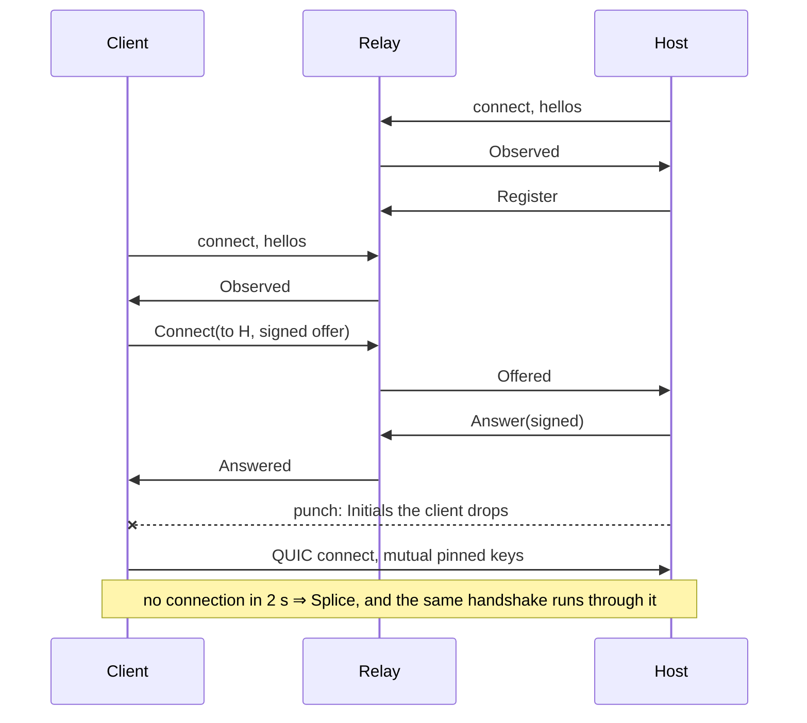

# tachyx relay (draft 0)

Status: draft. `relayd` (crate `tachyx-relayd`) and the peer side in
`tachyx-relay` implement what is written here. Anything not built says so.

The relay does four jobs and holds no session key for any of them.

1. **Presence.** A host keeps one connection open so a client can find it.
2. **Rendezvous.** Mailboxes for pairing, and offer and answer for connecting.
3. **Reflexive address reporting.** It tells each peer the address it saw that
   peer at. This is the STUN job, done over the connection that already exists.
   There is no separate STUN server and no third-party STUN server.
4. **Splicing.** When hole punching fails, it forwards opaque datagrams between
   two peers.

A hostile relay can drop traffic, delay it, lie about a reflexive address, and
see who talks to whom, when and how much. It cannot read a session, join one or
inject into one, because the session's own TLS runs end to end through it. That
makes a community relay and the paid fleet interchangeable. Every decision in
this document keeps that property.

## Reaching a relay

```
relay = "192.0.2.10:47990#GEZDGNBVGY3TQOJQGEZDGNBVGY3TQOJQGEZDGNBVGY3TQOJQGEZA"
```

The address, `#`, then the relay's `DeviceId` in base32. A bare `address:port`
names a relay the operator chose not to pin. A relay is a device like any other:
the same Ed25519 key, the same self-signed certificate, and the same exact-key
check when a key is written. The key travels in the address because a relay
address is configuration a person pastes once. Pinning on first sight would
leave that one moment undefended for no gain. `relayd` prints its own line in
this form at startup.

A bare address is a decision, not a default. A `#` followed by anything that is
not a key is refused, not read as "no key", so a typo cannot drop a pin. A peer
logs what an unpinned relay gives up at every connection, because a warning
shown once at configuration is forgotten.

Port 47990. The host listens on 47989.

A host registers with the first relay in its list only. That relay is its
**home relay**, and the host writes it into every pairing record. A client tries
the host's home relay first, then its own configured relays.

### What the relay's key does and does not buy

The key is not what makes the design zero-trust. A relay has a key because QUIC
has TLS and something must be presented. **Verifying** it buys one thing:
**metadata privacy.** Without the check, anyone who can intercept the relay's
address becomes the relay: it learns who this device reaches, when and how
much, and can force every session onto the relayed path by lying about the
reflexive address. With the check, that attacker can only deny service.

Everything above the metadata is safe either way. The session is end-to-end TLS
between two pinned device keys, and pairing is a balanced PAKE. A relay that is
hostile, impersonated or somebody else's cannot read a session, join one,
inject into one, or turn one online guess into two. So a deployment that does
not care who carries its ciphertext can leave the key off. Its sessions are
exactly as safe. It gives up knowing whose relay it is on.

## The connection

One QUIC connection, ALPN `tachyx-relay`. One bidirectional stream carries
control, framed as [`protocol.md`](protocol.md) frames the session's control
stream: a `u32` big-endian length, then that many `postcard` bytes. The first
message in each direction carries the version (`PeerHello`, `RelayHello`). A
control message larger than 16 KiB is refused.

The peer sends a keepalive every 20 s, which holds its NAT mapping open while a
host sits idle. The relay drops a connection after 60 s of silence. The
connection starts at a 1200-byte packet size and path discovery raises it.

Both ends present a certificate. The relay accepts any well-formed self-signed
Ed25519 certificate and takes its key as the peer's identity. It **authorises
nothing**: it needs a stable name to route by, not a decision about who may talk
to whom. The host makes that decision in its own TLS handshake, and nobody else
does.

Spliced traffic does **not** travel on this connection. It travels beside it,
on the same UDP port.

### One socket, two kinds of packet

A peer has exactly one UDP socket. The relay connection, the punch and the
session all leave from it. That is what makes the address the relay observes
the address the peer will be reached at.

quinn tells its own connections apart by connection ID, so the relay connection
and a direct session share the socket with no extra code. Spliced traffic is
separated one layer lower, by the bit QUIC reserves for this:

```
byte 0     = 0x2a   (0x40 clear; RFC 9000 §17.2 sets that bit in every QUIC
                     packet, so neither kind can be mistaken for the other)
bytes 1..9 = the lane token
bytes 9..  = the packet, verbatim
```

Nine bytes. That is the whole per-packet cost of being relayed.

Routing below quinn has two consequences.

**Send side.** quinn asks the *socket*, not the destination, how many datagrams
one send may carry. The socket reports what the kernel segments, so the direct
path keeps segmentation offload. For a relayed destination the socket splits
the send and wraps each datagram on its own, because the kernel would cut a
segmented send into pieces of which only the first carries a header. Only the
first datagram may report `WouldBlock`: a later failure drops the rest, as the
network would, because reporting it makes quinn resend the datagrams already
sent.

**Receive side.** The socket reports what the kernel really coalesces, because
quinn sizes its receive buffers from that number and a smaller figure truncates
a coalesced read. A coalesced batch can mix a relay's control packets with
spliced ones. Only the leading run of one kind is kept. The rest is loss that
QUIC repairs.

## What travels through a splice, and what does not

**The session's own QUIC packets travel through it, unwrapped.** The relay
rewrites the token and forwards the rest untouched. There is no second QUIC
connection, no second TLS handshake and no second congestion controller.

**Rejected: QUIC in QUIC.** Carrying the session as datagrams inside the relay
connection was measured and rejected:

- **38 bytes of header**, against 9. An inner datagram pays the outer short
  header, the outer connection ID, the outer packet number, the outer
  authentication tag and the DATAGRAM frame's own fields.
- **A floor, not a tax.** RFC 9000 requires datagrams that carry an Initial to
  be at least 1200 bytes, and quinn does not go below that. So an outer path
  with less than about 1238 bytes of UDP payload cannot carry an inner
  handshake **at all**. Measured: with outer datagrams capped at 1091 bytes, no
  inner handshake ever completed, because every Initial was dropped silently. A
  Tailscale interface has an MTU of 1280 by default. That leaves 1252 bytes of
  UDP payload over IPv4, a margin of under 15 bytes, and 1232 over IPv6, which
  is below the floor.
- **Two congestion controllers and two AEADs** on every relayed packet, with the
  outer controller pacing the inner one's idea of the link.

Forwarding at the UDP layer has one cost: the relay is addressed by a token, not
by an authenticated connection. The next section covers that.

### The lane token

`Splice` makes the relay draw two 8-byte tokens, one per direction, and give
each peer only its own. For each token the relay holds the one address that may
use it (which is also where packets for that end go) and the counterpart token.
It rewrites the token before it forwards a packet, so neither peer learns the
other's token.

- A forged token has one chance in 2⁶⁴. The relay drops a packet whose token it
  does not hold, without an answer, so there is nothing to probe.
- A token is bound to one address. A packet with the right token from another
  address is dropped, so a token overheard on the path cannot be replayed from
  elsewhere.
- **The relay never forwards more bytes toward an address than it has received
  from that address** until the address has proved itself: a one-to-one limit.
  QUIC has its own anti-amplification limit (three to one, RFC 9000 §8). A
  splice is below QUIC, so it has to state its own.

  The obvious proof deadlocks. The relay must know where a peer is *before* it
  can forward anything to it, and in a session the host never speaks first, so
  "the address that first used the token" never arrives. Instead, a lane end's
  address comes from that peer's **control connection**. On receiving its
  `Lane`, each peer sends one **empty spliced frame** (`0x2a` and its token),
  which the relay reads as proof of the address and does not forward. The far
  end hears of the lane first, so it can prove its address before the asking
  peer's traffic arrives. The relay checks each control connection's address
  every 5 s. A peer that moved is repointed, gets a new `Observed`, and must
  prove the new address.
- Tokens die with the lane. The lane dies with either control connection.

### The peer's address never changes, so nothing migrates

Each side gives the other a **virtual address**, drawn locally from
`240.0.0.0/4`. That block is reserved and never routed, and it is IPv4, so an
endpoint bound to either family can carry it. The address comes from a counter
and means nothing. The two sides never have to agree on it: quinn is told it,
and quinn is the only thing that reads it.

The socket underneath then routes: straight out the wire for a direct path, or
wrapped and sent to the relay. quinn is told the same remote address either
way. A direct session also gets a virtual address, so its route can change
later without quinn seeing a migration.

Measured: a session established through a relay and moved to a direct path
mid-connection kept the same `Connection`, reported the same `remote_address`,
and performed **no path validation and no migration**. Throughput went from
991 Mbit/s relayed to 1200 Mbit/s direct and RTT from 361 µs to 89 µs, on one
object throughout.

The same experiment showed the sharp edge of this design. One congestion
controller serves what are really two paths, so the window earned on the
relayed path is wrong the moment the path changes. Until that is solved, the
upgrade is off. See *Not built yet*.

## Messages

### Peer to relay

`PeerHello`
: The version, nothing else. There is no role field: a peer that wants to be
  reachable sends `Register`, and a peer that does not stays quiet. A version
  mismatch is refused by name.

`Register`
: Make me reachable under my identifier. A host sends this and keeps the
  connection. A client that only wants to reach somebody does not send it,
  which is why an answer cannot be routed by presence.

  Nothing acknowledges it. The relay sends `Observed` right after the hellos,
  before it reads any other message. So there is a window in which a host is
  connected and observed but not yet reachable, and a client that asks for it
  in that window gets `UnknownPeer`. That is correct behaviour, and it is the
  one race a test has to wait out.

`Allocate`
: Open a pairing mailbox. Answered with `Nameplate`.

`Join { nameplate }`
: Enter an open mailbox as its second party.

  Both first close any mailbox this connection was in.

`Mail { body }`
: For the other party of my mailbox. The relay forwards the bytes and reads
  none of them.

`Release`
: Close my mailbox now. Either party may close it.

`Connect { offer }`
: Reach the host the offer names. The relay reads `offer.to` to know where to
  forward it, and reads nothing else. It does not verify the signature: the
  signature is for the far end.

`Answer { offer }`
: The host's reply. Routed to `offer.to` over that device's open control
  connection, registered or not, never through presence: a client does not
  send `Register`, so it has no presence entry.

`Splice { peer }`
: Punching did not work. Open a relayed path to that peer.

### Relay to peer

`RelayHello`
: The version. Sent before the relay reads the peer's hello, so a peer of
  another version learns which version the relay speaks.

`Observed { address }`
: The address this connection was seen from. Sent unprompted right after the
  hellos, and again whenever it changes, which is what a NAT rebinding looks
  like from the relay.

`Nameplate { nameplate }`
: The mailbox that was opened.

`Mail { body }`
: What the other party of the mailbox sent. One flight sent before the joiner
  arrives is held and delivered at `Join`.

`Offered { offer }` and `Answered { offer }`
: What arrived. The sender is `offer.from`, inside the signature, which is
  where the reader has to check it anyway.

`Lane { token, peer }`
: A relayed path is open. A packet sent to the relay's own address that begins
  with `0x2a` and this token reaches that peer.

`Refused { what }`
: What could not be done and why: `UnknownPeer`, `UnknownNameplate`,
  `NameplateTaken`, `NoNameplates`, `NotInMailbox`, `RateLimited`. Enough for a
  client to say something a person can act on. The enum also has `BadOffer`,
  which `relayd` never sends because it does not verify offers. A peer's own
  `Offer::verify` returns it.

## The offer is signed, not sealed

```rust
pub struct Offer {
    pub from: DeviceId,
    pub to: DeviceId,
    /// Addresses to try. The peer's own view of itself first, then what the
    /// relay observed.
    pub candidates: Vec<SocketAddr>,
    /// Seconds since the Unix epoch.
    pub at: u64,
    /// Ed25519 over everything above, in `postcard`, under the domain
    /// "tachyx-offer-v1".
    pub signature: Signature,
}
```

`to` is inside the signature, so an offer collected for one host cannot be
replayed at another. The signed bytes are `0x0f`, then `tachyx-offer-v1`, then
the body: the signing domain travels with its one-byte length in front. A
reimplementation that leaves out the length produces signatures that do not
verify.

`at` is checked against a wide window, 60 seconds either way, because the two
clocks are not related.

Two bounds limit what a signed offer can cost the host.

**Replay.** Inside the window the reader catches a replay, not the relay. An
offer needs no nonce, because its signature is already unique to its content.
The host remembers the signatures it has answered inside the window. A repeat
is dropped after the signature and paired-list checks, and costs the host one
comparison.

**Candidate cap.** Each address in an offer costs the reader a punch attempt,
and a punch attempt is a 1200-byte QUIC Initial sent where the offer says. The
16 KiB message limit alone would allow about 2300 addresses, which turns one
offer into 2.7 MB aimed wherever the signer likes: an amplifier of about 170.
An offer that names more than 12 is refused (`MAX_CANDIDATES`), and a peer cuts
its own list to 12. A host has a link-local address or two, one routable
address, and the one the relay observed.

The host verifies the signature against its paired list **before it sends one
packet to any address the offer names.** That is what the signature is for. An
unsigned offer would make every relay a reflector: ask it to reach a host, name
the victim's address, and the host sprays QUIC Initials at the victim. The
client checks the host's answer the same way, and also checks that it is from
the host it asked and addressed to itself.

Sealing the offer to the host's key was considered and dropped. It would hide
the candidate addresses from the relay, but the relay observes the client's
real address itself, so it would hide nothing the relay does not already have.

## Connecting, in order

Before it asks a relay, the client tries each endpoint stored at pairing,
briefly. If none answers:



### The punch

Both ends already hold a UDP socket that the relay has seen, so the mapping a
NAT made for the relay is the mapping the peer will arrive at. Nothing else has
to be discovered.

**Only the client makes the real connection.** The host punches by starting a
connection of its own toward each of the client's candidates and abandoning it.
Its Initials open the host's NAT mapping and are then dropped: the client's
endpoint has no server configuration, so quinn discards an incoming Initial
without answering. The host cancels its attempts when the client's connection
arrives, or after 3 s.

This is a deliberate choice against racing two real connections and closing the
loser. Racing costs a second handshake, needs a rule for which side wins, and
leaves a window where both are live. One direction is one code path.

The client waits up to 5 s for the answer. It then tries the host's candidates
in turn, each for an equal share of its 2 s punch budget but never less than
400 ms.

### When the punch fails

After 2 s without a direct connection, the client asks for a splice. The relay
draws the two tokens, tells both peers, and forwards from then on.

**The session through the splice is the same session**, in the strongest sense
available: the same `Connection`, ALPN, certificates, key comparison and
congestion controller. Only the socket underneath knows it is relayed: it adds
nine bytes and changes where packets go.

#### The path is smaller and the video already knows

A splice adds nine bytes, and the path underneath may be a 1280-byte interface.
The video packetiser reads `quinn::Connection::max_datagram_size` on every
frame, so a smaller path resizes the slices with no other change.

The starting packet size must move.
[`endpoint.rs`](../crates/tachyx-transport/src/endpoint.rs) defines `LAN_MTU`
(1472) for a socket that sends straight out the wire and `RELAYED_MTU` (1200)
for a path that may be relayed. On a 1280-byte path every 1472-byte packet is
black-holed until discovery notices, which stalls the session as it opens. So
the host and every relay connection start at 1200. The client starts at 1472
for its direct try at stored endpoints and at 1200 once a relay is involved.
Path discovery raises the figure on a larger path.

## Abuse

A public relay is a machine strangers can reach.

- New connections are rate limited per source prefix: the IPv6 `/64`, because
  one subscriber is handed a whole one, or the IPv4 address. 30 a minute, with
  a burst of 10.
- A connection is judged before it costs anything. quinn hands the accept loop
  an `Incoming` before the handshake commits, which says whether the source
  address is validated and offers `retry`, `refuse` and `ignore`. An
  unvalidated address over budget gets a retry: one packet, and the address
  must answer it. A validated address still over budget is ignored, which sends
  nothing.
- quinn's defaults for `max_incoming` and `incoming_buffer_size_total` are 65536
  and 100 MiB, far too generous for a relay. `relayd` sets 256 and 4 MiB.
- Control messages are rate limited per connection: 10 a second, with a burst
  of 20. A message over budget is answered with `RateLimited`.
- A mailbox lives five minutes and holds one message toward the joiner. The
  opener stays connected for as long as the mailbox lives, because the mailbox
  dies with either party's connection.
- A nameplate is not reusable **while it is open**, and is not guessable in
  sequence: it is drawn at random from 1 to 65535 and freed when its mailbox
  closes. Never reusing one would cap a relay at 65535 pairings for its
  lifetime. Reuse is safe because the exchange is keyed on the nameplate *and*
  the secret, so a stale code cannot open a new mailbox.
- Spliced bytes are counted per lane end, received and sent, and logged when
  the lane closes: the number a metered deployment would bill and an unmetered
  one watches for abuse.
- Nothing is stored. A restarted relay has forgotten everything, and every host
  reconnects. Every 30 s the relay closes expired mailboxes and prunes the rate
  limiter's map, which would otherwise grow one entry per source forever.

## Not built yet

Billing, blind tokens, the signed relay directory, and relay selection by
measured round trip.

**Moving a live relayed session to a direct path.** The mechanism is built and
proven, and nothing in the daemon drives it. `Routes::point` swaps the route
and quinn never learns. Measured on a real session: the connection reported
`240.0.0.1:1` before and after, the relay carried no further bytes, and the
round trip fell from 373 to 263 µs. Only the tests call it.

The missing part is the congestion controller, not the swap. It has one window
and one round-trip estimate for what has just become a different path. The
window a relayed path earned is wrong on a direct path, and the reverse is
worse. Until that is solved, the route is chosen when the session opens and
kept.

## What was measured and what was read

**Measured**, by building it and running it:

- One quinn endpoint holds three connections on one UDP port at once: outbound
  to a relay, outbound to a peer, and inbound from that peer, with the local
  address unchanged. Port reuse is not the obstacle to punching.
- A session over a virtual socket switched from relayed to direct
  mid-connection with no migration, no path validation and no new handshake.
- QUIC in QUIC stops working entirely below about 1238 bytes of outer UDP
  payload. It does not degrade first.

**Read**, from the sources named:

- quinn 0.11 gives the application no way to move a connection to a new peer
  address. `Endpoint::rebind` changes the local socket, and server-side
  migration is passive. This is why the virtual address exists.
- Hole punching succeeds for roughly 70% of attempts in libp2p's published
  measurement of 4.43M tries (Trautwein et al., IMC 2026), and Tailscale
  reports over 90% of node pairs direct. The 85 to 90% target in
  [`architecture.md`](architecture.md) is inside that range. This project has
  not measured it.
- The often-quoted "15 to 30% of users are behind symmetric NAT" has no primary
  source and is not used here. The best figures are Halkes and Pouwelse 2011:
  11% endpoint-dependent mapping, 79% not directly connectable.
- A NAT mapping should be refreshed at least every 55 seconds. 15 to 25 seconds
  is the safe operating point.
